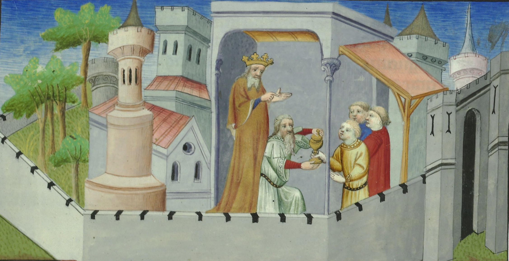
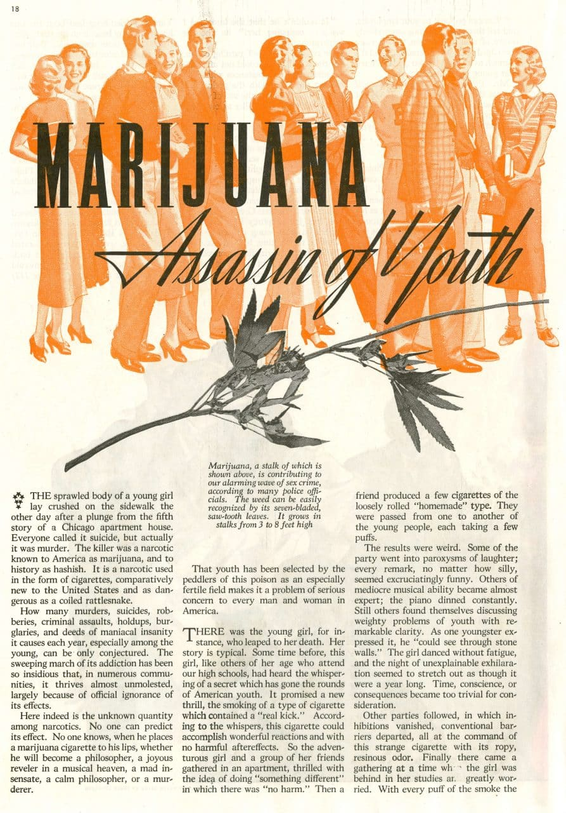

*Assassin* is the European word that a story about cannabis put into everyday use. It comes from *ḥashīshiyya*, an Arabic term of abuse for the Nizari Ismailis of Syria, a Shiʿi community whose agents killed rulers and officials in the twelfth and thirteenth centuries. European observers carried the name home, and it came to mean a killer, especially one who strikes by stealth or for pay.[@1,4,6,9]

The Nizaris did carry out political killings. The claim that [hashish](/culture/language/hashish/) drove them is a European legend, not a record of Nizari practice. That legend was repeated by Marco Polo and gained scholarly authority when Silvestre de Sacy explained the word’s etymology in 1809. In 1937 it returned in American cannabis propaganda as “assassin of youth”.[@8,9,10,11]

## An insult without an explanation

The oldest known use is a decree of the Fatimid caliph al-Āmir, written in 1122–1123 against the Nizaris. Its appendix, sent to the caliph’s agents in Damascus, calls them *al-ḥashīshiyya*, “without any explanation”, as Farhad Daftary notes.[@1,11]

Twelfth-century Seljuq chroniclers used the word alongside *bāṭiniyya* (“those of the hidden meaning”) and *malāḥida* (“heretics”). Ibn Muyassar recorded the labels below.[@1] Jerzy Hauziński reads *ḥashīshiyya* as a jibe at the low standing of the Syrian followers: “simple and fanatic” people.[@1] Daftary and the Turkish encyclopedia of Islam agree that it meant “low-class rabble” or people of lax morality, not a description of drug use.[@4,11]

| Where | What the Nizaris were called, according to Ibn Muyassar |
|---|---|
| Syria | *ḥashīshiyya* |
| Alamut, Persia | *bāṭiniyya*, *malāḥida* |
| Khurasan | *taʿlīmiyya* |

## What the Nizaris actually did

Under Hasan Sabbah (d. 1124) the Nizaris built a state centred on the mountain fortress of Alamut in Persia, with a subsidiary in Syria. Their fidaʾis killed prominent political and military enemies, as a policy meant to intimidate. Daftary describes young volunteers acting from religious conviction, often waiting patiently for an opportunity. No contemporary source says hashish was used to motivate them.[@11]

The state fell to the Mongols in 1256. The community survived as a Shiʿi minority; modern Nizaris, scattered across more than 25 countries, acknowledge the Aga Khan as their imam.[@10,11]

## The Old Man and his garden

From the late twelfth century, Western observers explained the fidaʾis’ self-sacrifice by an intoxicating drug: the “Old Man of the Mountain”, their name for the Nizari leader, supposedly controlled them with a potion and a secret garden of paradise.[@10,11] The Crusaders’ “Old Man” was the Syrian leader Rashid al-Din Sinan (d. 1193), not Hasan Sabbah.[@9] Marco Polo gave it its most influential form. The Old Man, he said, kept a walled garden made to look like paradise. Youths from twelve to twenty were given “a certain potion which cast them into a deep sleep” and carried in; woken among wine and music, they believed they were in paradise and would die to return. Polo calls them *Ashishin* and does not say what the potion was.[@2]

The picture above, painted in Paris about 1410–1412, comes from a manuscript of Polo’s travels. Its rubric reads “Cy parle du viel de la montaigne et de son estat” (“Here it speaks of the Old Man of the Mountain and his estate”). It names no Hasan Sabbah and shows music and pleasure, not a training camp.[@12]

Daftary called the tales “fabricated by uninformed writers and the enemies of the sect”; modern scholarship has found no evidence that hashish was used systematically on the fidaʾis.[@11] The legend says more about Europe than Nizari practice.

## The 1809 etymology

The explanation repeated ever since was the work of [Silvestre de Sacy](/history/france-sacy-assassins-lecture-1809/), a French orientalist. In a lecture at the Institut de France in 1809, published in full in 1818, he rejected earlier guesses and showed that the Crusader and European forms of *assassin* came from the Arabic *ḥashīsh*, citing Abū Shāma’s thirteenth-century chronicle.[@11] He took it to mean “hashish-eater”, the name of a sect of drugged killers.[@5,11]

The drugging story was already centuries old; de Sacy supplied the etymology and the appearance of learned proof. He accepted that the Nizari chief used hashish, though sparingly rather than habitually, to give his followers dreams of paradise. His authority fixed the link in European scholarship.[@10,11]

David Guba traces how that reading tied hashish to the Orient and to violent madness in French medicine, in the circle of [Jacques-Joseph Moreau](/culture/people/jacques-joseph-moreau/) and the [Club des Hashischins](/culture/traditions/club-des-hashischins/), and later in French drug law.[@5]

## From the Old Man to “assassin of youth”

By the early fourteenth century Dante could write of “lo perfido assessin”, the treacherous assassin, with no Syria in view.[@3] A fourteenth-century commentator defined the *assassino* as “one who kills others for money”.[@7]

By the nineteenth century the drugged Assassin was familiar in Orientalist scholarship; by the twentieth, the association could be turned against cannabis itself.[@5,11] In July 1937, as Congress debated the Marihuana Tax Act, *The American Magazine* published “[Marijuana, Assassin of Youth](/history/us-assassin-of-youth-1937/)”, associated with the narcotics commissioner [Harry Anslinger](/culture/people/harry-anslinger/). Its stories made cannabis itself the killer, a cause of violence and youthful ruin.[@8] A [film of the same name](/history/us-assassin-of-youth-film-1937/) followed the same year.

An insult from a twelfth-century quarrel over the imamate had become part of the case for prohibition.
