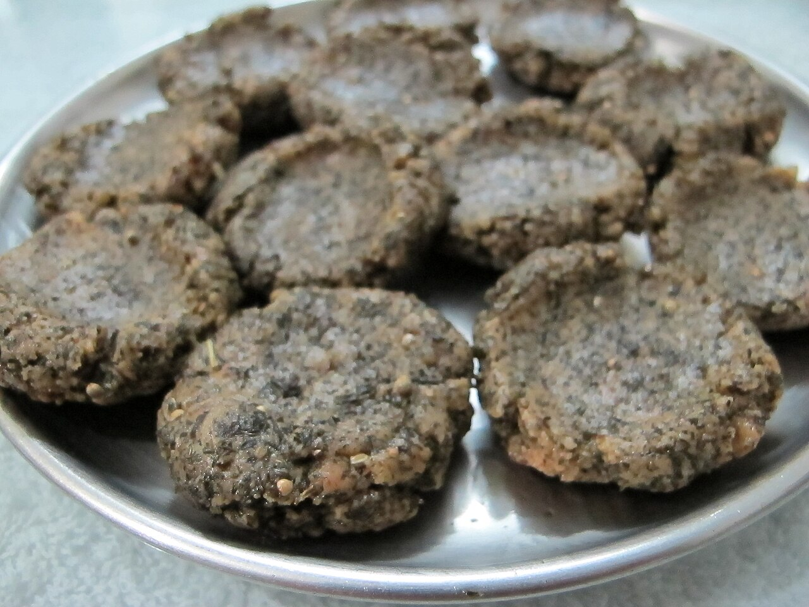

Bhang is the leaf of the cannabis plant, ground to a green paste and eaten or drunk. Indian terminology distinguishes it from the flowering tops and resin; the national law also treats those materials differently.

## Leaf, flower, resin

Indian usage divides the plant in three, and the law follows the words.

| Word | Part of the plant | How it is taken | National law since 1985 |
|---|---|---|---|
| Bhang | Leaves (and seeds) | Eaten or drunk | Not covered; left to the states |
| [Ganja](/culture/language/ganja/) | Flowering tops | Smoked | Banned |
| [Charas](/culture/language/charas/) | Resin | Smoked | Banned |

The [Narcotic Drugs and Psychotropic Substances Act](/history/india-ndps-act-1985/) defines cannabis as charas and ganja, and expressly leaves out "the seeds and leaves when not accompanied by the tops". The wording is copied from the [1961 Single Convention](https://en.wikipedia.org/wiki/Single_Convention_on_Narcotic_Drugs), and it is there because [India's delegates insisted on it](/history/india-bhang-exemption-1961/).

Historical usage was less exact than the statutory distinction. Mills reproduces the 1894 commission's warning that *bhang* could name a drink made from flowering material as well as leaves. The commissioners also found regional differences, including places where *ganja* was the more general word. An old reference to bhang therefore does not establish its botanical ingredients or its status under a later law.

## How it is made

The leaves are ground with a mortar and pestle. For a drink the paste is stirred into milk, strained, and flavoured with sugar, fruit and spices. The best-known drinks are bhang [thandai](https://en.wikipedia.org/wiki/Thandai), a cold milk drink with almonds, fennel, pepper, cardamom and saffron, and bhang [lassi](https://en.wikipedia.org/wiki/Lassi), made with curd.

Khwaja A. Hasan’s 1975 chapter describes [thandai gatherings](/culture/traditions/thandai-gatherings/) where relatives or friends ground ingredients together while discussing household matters and prices. His account also records caste boundaries between groups. It describes social preparation in particular north Indian settings, not an undifferentiated national custom.

It is also eaten. Mixed with ghee and sugar it becomes a halva; rolled into peppery balls it is *goli*, which means pill; and at Holi it goes into fried pakoras. In Nepal the seeds are ground into a pickle with potato, *bhang ko achar*.

## An old word, an older argument

A plant called *bhanga* appears in the Atharvaveda, among five plants that "free us from distress", and in early medical texts. Whether that *bhanga* is cannabis is disputed among Sanskrit scholars. According to the historians of Indian medicine Meulenbeld and Wujastyk, the earliest text that mentions cannabis beyond dispute dates from the late eleventh century, and recommends it as an appetiser and digestive. In Ayurvedic texts the plant is also called *vijaya*.

The custom is tied to Shiva. One story has the god sleeping under the plant and waking refreshed by its leaves; another has bhang given to cool him after he drank the poison that rose from the churning of the ocean. Bhang is still offered to him and taken as his *prasad*, above all between Maha Shivaratri and [Holi](/culture/traditions/bhang-at-holi/).

## What Europeans made of it

The Portuguese met bhang in Goa. The physician [Garcia de Orta](https://en.wikipedia.org/wiki/Garcia_de_Orta) wrote about "bangue" in his *Colóquios* of 1563, noting that people took it to work and to eat better: "it is so generally used and by such a number of people that there is no mystery about it". The Dutch traveller Jan Huyghen van Linschoten gave it three pages in 1596.

The British [taxed it from 1798](/history/india-bhang-tax-1798/) and held an inquiry a century later. The [Indian Hemp Drugs Commission](/history/india-hemp-drugs-commission-1894/) heard nearly 1,200 witnesses and found that moderate use "practically produces no ill effects".

The word travelled west and south as well. In Persian it is *bang*, and [Iran's penal law of 1926](/history/iran-penal-law-1926/) punished public intoxication with it. In Swahili it became [bangi](/culture/language/bangi/), the ordinary word for cannabis in East Africa.

## Where it is legal today

Because the national law is silent, each state decides.

| State | Rule |
|---|---|
| Uttar Pradesh | Licensed bhang shops |
| Bihar, West Bengal | Production allowed |
| Rajasthan | Sale allowed, of bhang brought from states where it is made |
| Gujarat | [Taken off the list of intoxicants in 2017](/history/india-gujarat-bhang-2017/) |
| Maharashtra | Banned without a licence under the prohibition act of 1949 |
| Assam | [Banned since 1958](/history/india-assam-ganja-bhang-act-1958/), yet drunk openly at the Ambubachi Mela |

In a national survey of 2019, more people reported taking bhang than smoking ganja or charas.
