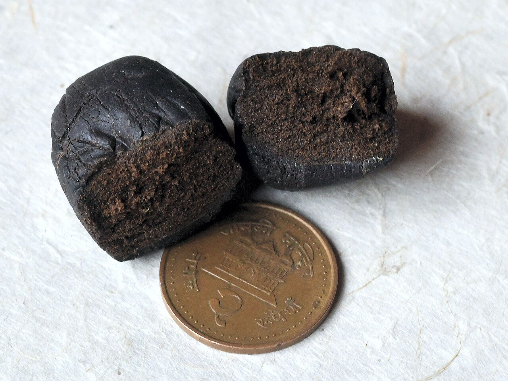
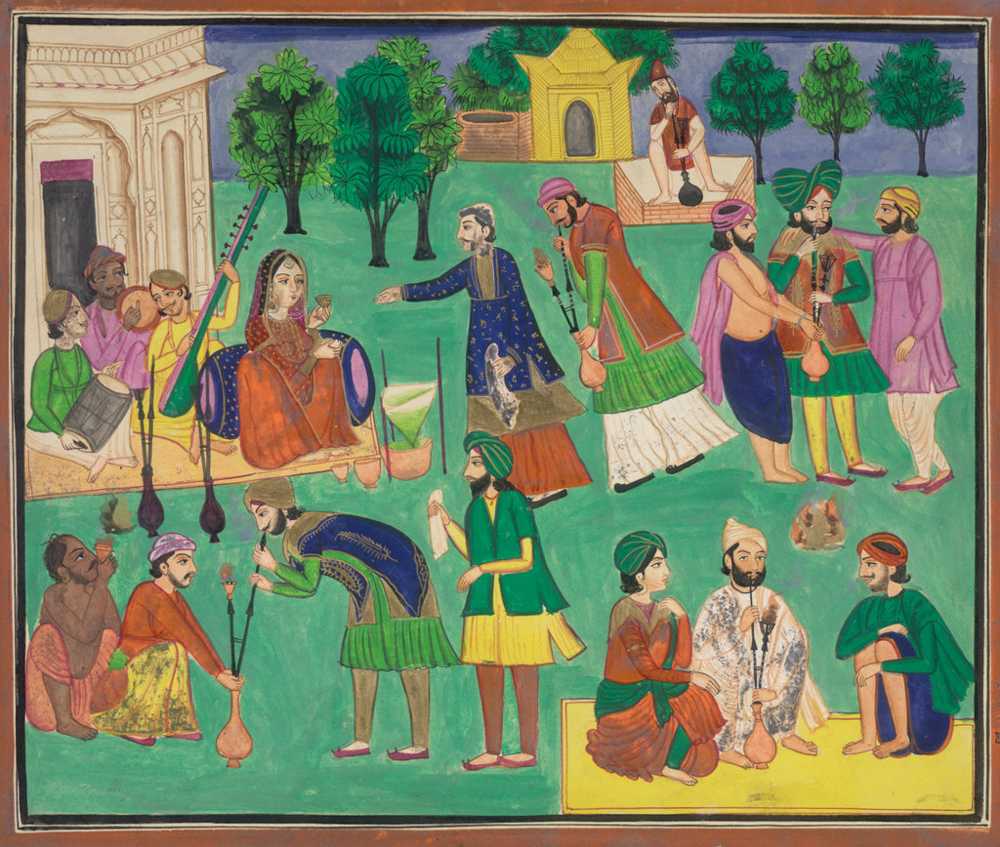

Charas is cannabis resin gathered by hand from the living plant. It is the hashish of the Himalaya, made in the mountain valleys of northern India, Nepal and Pakistan, and it is the form in which the plant is smoked by Hindu ascetics. Indian law names it: charas is the first thing listed in the national definition of cannabis.

## Rubbed, not sieved

At harvest the flowering tops of the living plants are rubbed between the palms. The resin sticks to the skin and is scraped off. That is the difference from [hashish](/culture/language/hashish/) in the narrow sense, which is sieved from plants that have been cut and dried.

The plant grows wild along the whole range. In India the best-known charas comes from Himachal Pradesh: the Parvati valley, the villages of Kasol and Rasol, and above all Malana, whose product is sold as "Malana cream". It is a cash crop for mountain farmers and a reason backpackers come.

## The Central Asian trade

In the nineteenth century much of the charas smoked in northern India came from outside it. Xinjiang, in Chinese Turkestan, was a major producer, with Yarkand as its centre, and exported tens of thousands of kilograms a year to British India, legally and under a tariff. A gouache painted in Amritsar about 1870 shows men smoking "charras … imported into northern India from Eastern Turkestan". China [ended the legal trade in 1934](/history/china-xinjiang-hashish-trade-ended-1934/); smuggling went on for some years.

## Sold by the government

Bengal’s Board [recommended taxing cannabis preparations in 1798](/history/india-bhang-tax-1798/). Later, charas was sold through licensed shops under provincial excise systems, alongside [ganja](/culture/language/ganja/) and [bhang](/culture/language/bhang/). Provinces experimented. The Central Provinces [banned its sale in 1925](/history/india-central-provinces-charas-1925/), saw smuggling take over, and licensed it again in 1935 with shops at Nagpur and Jubbulpore.

Nepal kept the system longest. Nepalese charas had a reputation as the best available as early as the 1700s, and until the 1970s licensed dealers sold it in Kathmandu, latterly to the Western travellers of the [hippie trail](https://en.wikipedia.org/wiki/Hippie_trail), on the lane still nicknamed Freak Street. Nepal cancelled every licence in 1973 and banned cannabis outright in 1976.

## The sacred smoke

Among the Shaiva orders, charas is venerated as an aspect of Shiva. The Naga sadhus and the Aghoris smoke it in the clay [chillum](/culture/traditions/sadhus-and-the-chillum/) as part of their practice, calling out the god's names before the pipe is lit.

## The law

| Country | Law | What it says |
|---|---|---|
| India | [NDPS Act, 1985](/history/india-ndps-act-1985/) | Charas is "the separated resin, in whatever form, whether crude or purified"; banned everywhere |
| Nepal | Narcotic Drugs (Control) Act, 1976 | Banned, though the act lets the government make rules for producing "hashish (chares)" from wild plants of the western hills |
| Pakistan | [Prohibition order, 1979](/history/pakistan-prohibition-1979/), and the act of 1997 | Banned; personal use is often overlooked, and in some tribal areas it is sold in markets |
| Iran | [Penal law of 1926](/history/iran-penal-law-1926/) | Punished public intoxication with charas |

The word has outlasted every ban. It is still what the resin is called from Peshawar to Kathmandu, and in Pakistan cannabis is "widely consumed as charas and bhang".
