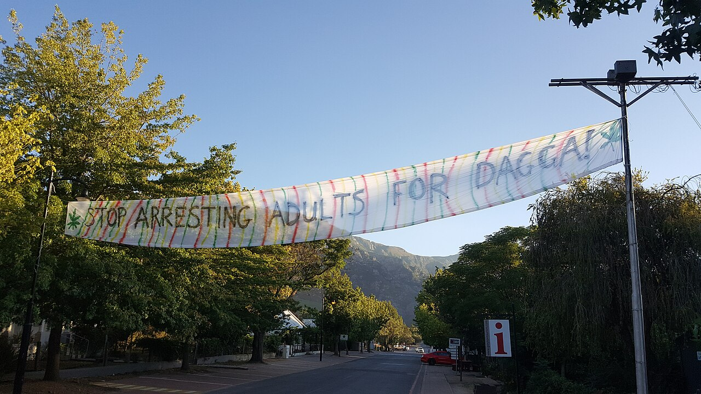

Dagga is what cannabis is called in South Africa and its neighbours. It is a Khoekhoe word, taken up by the Dutch at the Cape in the seventeenth century, written into colonial law in the nineteenth, turned into a word of contempt in the twentieth, and deliberately taken back in the twenty-first.

## A Khoekhoe word

The source is the Khoekhoe *daxa*, said with the rasping sound that survives in the Afrikaans *g*. The Khoekhoe used it for cannabis and also for species of [*Leonotis*](https://en.wikipedia.org/wiki/Leonotis_leonurus), the shrub still called wild dagga, whose leaves resemble those of cannabis. According to the Oxford dictionary the word also described the feeling of intoxication.

Its first appearance in writing is in the journal of [Jan van Riebeeck](https://en.wikipedia.org/wiki/Jan_van_Riebeeck), commander of the Dutch station at the Cape, in 1658. He ordered that "daccha" be bought in Natal to trade with the Khoekhoe. He may have meant the wild plant; some scholars doubt that anyone could confuse two plants with such different flowers.

Where the Khoekhoe word itself comes from is argued over.

| Theory | Proposed by |
|---|---|
| From Dutch *tabak*, tobacco, by way of *twak*, *twaga*, *toaga* | Hahn and Lichtenstein |
| From Khoekhoe *daXa-b*, tobacco; with *!am*, green, giving "green tobacco" | Brian du Toit, *Cannabis in Africa* (1980); supported by Jean Branford's *Dictionary of South African English* (1978) |

Over three centuries it has been spelled *daccha*, *dacha*, *dacka*, *dagha*, *daggha*, *tagga* and *daga*.

## The other names

Dagga is the word of Afrikaans and of South African English. The African languages have their own.

| Language or country | Word |
|---|---|
| isiZulu, siSwati | [insangu](/culture/traditions/the-morning-pipe/) |
| Sesotho | [matekoane](/culture/language/matekoane/) |
| In Zimbabwe | [mbanje](/culture/language/mbanje/) |
| In Malawi | [chamba](/culture/language/chamba/) |

## The word of the law

The plant was in wide use among Khoisan and Bantu-speaking peoples before the Dutch arrived in 1652. The Dutch East India Company tried to make a monopoly of it, forbidding settlers to grow it from 1680, found there was no profit in a plant that grew everywhere, and lifted the ban in 1700.

The first modern laws used the botanical name and were aimed at one group. Natal's [law of 1870](/history/south-africa-natal-1870/) forbade Indian indentured labourers to smoke, use or possess "any portion of the hemp plant". After that the statutes say dagga.

| Year | Law |
|---|---|
| [1903](/history/orange-river-colony-dagga-ordinance-1903/) | The Orange River Colony's Dagga Prohibition Ordinance |
| [1905](/history/cape-colony-dagga-poison-listing-1905/) | The Cape lists dagga as a poison, to be sold only by chemists. Dagga farmers of the Middelburg district petition against it |
| [1916](/history/south-africa-habit-forming-drugs-bill-1916/) | A draft national bill lists the wild *Leonotis* as dagga, separately from Indian hemp |
| [1922](/history/south-africa-national-ban-1922/) | National prohibition of growing, selling, possessing and using it |
| [1923](/history/south-africa-league-request-1923/) | South Africa asks the League of Nations to put dagga on its list of dangerous drugs |

In the Transvaal of those years it was sold "openly and normally" by storekeepers to miners, and the mine managers [saw no reason to stop it](/history/transvaal-mine-dagga-survey-1908/).

## A word turned into an insult

The National Party came to power in 1948 and kept the prohibition. Being an Afrikaans party, and the syllable *ga* already being an expression of disgust in the language, its people leaned on the word to pour scorn on the drug and on anyone who used it. Convictions fell, a government committee [reported in 1952](/history/south-africa-dagga-committee-1952/), almost entirely on Africans and Coloured people. Dagga became a word many users would not say.

## Taken back

The campaigners of the 2000s chose it on purpose. Jeremy Acton founded the [Dagga Party](/history/south-africa-dagga-party-2009/) in 2009. Julian Stobbs and Myrtle Clarke, arrested at home in 2010 with more than the 115 grams that the law treated as dealing, were named [the Dagga Couple](https://en.wikipedia.org/wiki/Dagga_Couple) by the press, kept the name, and sued seven government departments in what became known as the Trial of the Plant.

Acton was one of the applicants in the case that ended the ban on private use. On 18 September 2018 the [Constitutional Court](/history/south-africa-constitutional-court-2018/) ruled that adults may use, possess and grow cannabis in private. The act that followed in 2024 is the [Cannabis for Private Purposes Act](/history/south-africa-private-purposes-act-2024/): the legislators preferred the Latin.
