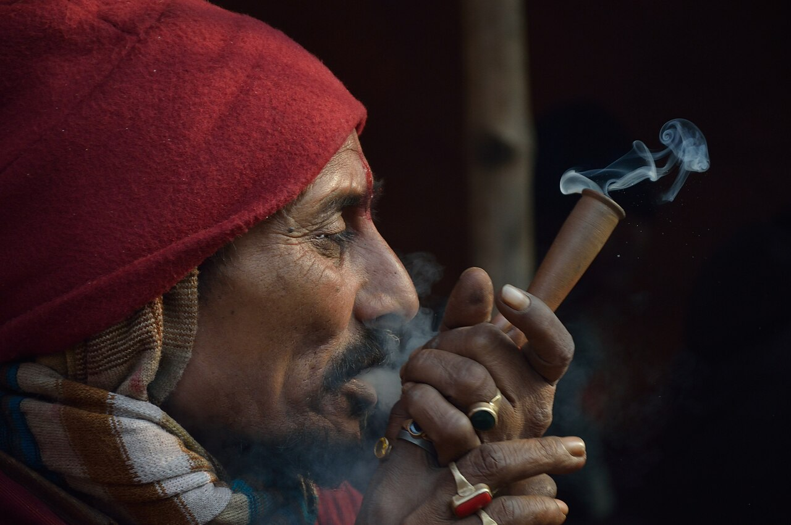

Ganja is the Hindi word for the flowering tops of the cannabis plant. It is one of the oldest names for cannabis in English, and one of the most travelled: carried west to the Caribbean by Indian labourers and east across South-East Asia, it is today the ordinary word for the plant from Kingston to Bangkok.

## What it names

In India the word is exact. *Gāñjā* is the flowering or fruiting top, as against [bhang](/culture/language/bhang/), the leaf, and [charas](/culture/language/charas/), the resin. India's [narcotics act of 1985](/history/india-ndps-act-1985/) uses the word as a legal term and defines it that way.

It comes from Sanskrit *gañjā*. English had borrowed it by 1689.

## A government crop

The British in India did not ban ganja; they licensed it. From 1798 it was [taxed](/history/india-bhang-tax-1798/), and in Bengal the whole supply was brought under official control. Growing was centred on the district of Naogaon, now in Bangladesh, where the crop was [organised from 1906](/history/bangladesh-naogaon-cultivation-1906/) and the 7,000 growers were formed in 1917 into the [Ganja Cultivators' Cooperative Society](/history/bangladesh-ganja-society-1917/). They delivered the harvest to guarded government warehouses, and the society's profits paid for schools, dispensaries, mosques and a bridge.

The system outlived the empire. Bangladesh [stopped cultivation only in 1987](/history/bangladesh-cultivation-ban-1987/). The [Ganja Society](https://en.wikipedia.org/wiki/Ganja_Society) still exists and still owns its warehouses.

## To the Caribbean

From 1845 Britain shipped indentured Indian labourers to the sugar estates of the Caribbean. They brought the plant, the habit of smoking it and the word. In Jamaica the ganja they used was at first imported from licensed dealers in Bengal.

The colonial laws took the name. Trinidad's [Ganja Ordinance of 1915](https://en.wikipedia.org/wiki/Cannabis_in_Trinidad_and_Tobago) copied the Bengal system of bonded warehouses and licensed sellers, and was replaced by a [ban in 1925](/history/trinidad-ganja-ordinance-1925/). Jamaica's first prohibition, pressed by the churches, was the [Ganja Law of 1913](/history/jamaica-ganja-law-1913/).

The [Rastafari](/culture/traditions/rastafari-sacrament/), whose movement arose in Jamaica in the 1930s, made the plant a sacrament and kept the Indian word. Reggae then carried it around the world: Peter Tosh's "Legalize It" of 1976 is a song about ganja by name.

## To South-East Asia

Cannabis is thought to have reached South-East Asia from India, and the names are the evidence.

| Language | Word |
|---|---|
| Hindi | गांजा, *gāñjā* |
| Thai | กัญชา, *kancha* |
| Khmer | កញ្ឆា, *kanhchha* |
| Lao | ກັນຊາ, *kan sa* |
| Vietnamese | *cần sa* |
| Malay and Indonesian | *ganja* |

In these countries the word covers the whole plant, not one part of it. When Thailand [took cannabis off its narcotics list](/history/thailand-decriminalisation-2022/) in 2022, the official app for registering plants was called *Plookganja*, "grow ganja".

## The word in law today

| Country | Where the word stands |
|---|---|
| [India](/country/in/) | A legal term: the banned flowering tops |
| [Bangladesh](/country/bd/) | The crop the state grew until 1987 and [banned in 1989](/history/bangladesh-ban-1989/) |
| [Jamaica](/country/jm/) | The name of the 1913 law, and of the plant in the [reform of 2015](/history/jamaica-ganja-reform-2015/) |
| [Trinidad and Tobago](/country/tt/) | The name of the 1915 and 1925 ordinances |
| [Thailand](/country/th/) | The everyday and official word |
