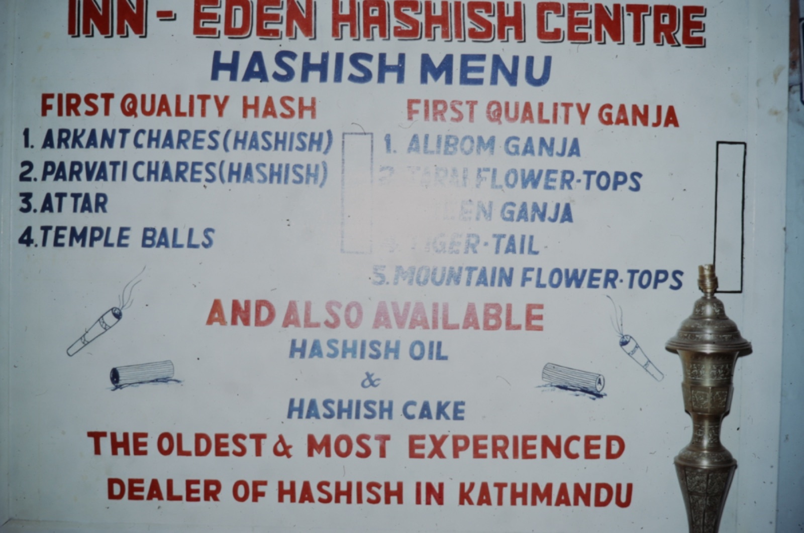

*Ḥashīsh* is an ordinary Arabic word for dried grass or fodder. As the name of a drug it means the resin of the cannabis plant, collected and pressed, and it is the word under which Europe first learned that cannabis could be eaten or smoked for its effect. It names the product from Morocco to Afghanistan, and it gave the West a second word, *assassin*, on the strength of a nineteenth-century theory about a medieval sect.

## From grass to resin

In Arabic the word means dried herbage, from a root to do with mowing and drying. Nothing like it is used for a drug in the Arabic writing of the ninth and tenth centuries. One of the earliest traces is a letter of the Fatimid caliph al-Āmir, about 1123, which abuses his opponents as *ḥashīshiyya*.

Until the sixteenth century hashish in the Muslim world was eaten. Smoking came to the Old World only with tobacco. The jurist Ibn Taymiyyah, who died in 1328, held that it should be forbidden; others disagreed, and in Persia, where Sufi orders used it and physicians prescribed it, the argument ran for centuries.

In modern usage, and in law, hashish is the resin. The 1961 [Single Convention](https://en.wikipedia.org/wiki/Single_Convention_on_Narcotic_Drugs) defines cannabis resin as "the separated resin, whether crude or purified, obtained from the cannabis plant". In the Indian subcontinent the same product is [charas](/culture/language/charas/), and in Morocco the powder it is pressed from is [kif](/culture/language/kif/).

## How Europe met it

The [Club des Hashischins](/culture/traditions/club-des-hashischins/) entry follows the Paris gatherings and distinguishes their documentary record from the literary legend.

Hashish reached Europe from the East in the eighteenth century, and Napoleon's campaign in Egypt introduced French troops to it. The soldiers took to it so readily that their commanders [banned it in 1800](/history/egypt-french-ban-1800/).

In France it became a subject of science and of letters.

| Year | What happened |
|---|---|
| [1809](/history/france-sacy-assassins-lecture-1809/) | The philologist Silvestre de Sacy argued that *assassin* came from *Hachichin*, hashish-eater, the supposed name of a medieval sect of drugged killers. The story tied hashish to the Orient and to violent madness |
| [1844](/history/france-club-des-hashischins-1844/) | The Club des Hashischins began meeting in Paris; its circle included Gautier, Baudelaire, Nerval, Delacroix and Dumas |
| [1845](/history/france-moreau-du-hachisch-1845/) | The psychiatrist Moreau de Tours proposed hashish as a means of studying mental illness |
| [1860](/history/france-paradis-artificiels-1860/) | Baudelaire published *Les Paradis artificiels* |

By the end of the century preparations of it were in pharmacies across Europe and North America, used against pain, migraine, asthma and sleeplessness.

## The countries of hashish

At the start of the twentieth century most hashish in Europe came from Kashmir and other parts of India, from Afghanistan, and from Greece, Syria, Nepal, Lebanon and Turkey. The sources changed with politics.

| Country | Its part in the story |
|---|---|
| [Egypt](/country/eg/) | Used there since at least the thirteenth century. [Forbade it in 1868](/history/egypt-first-ban-1868/), one of the first national bans |
| [Greece](/country/gr/) | Produced it for centuries and [banned it in 1890](/history/greece-hashish-ban-1890/). Refugees from Turkey after 1922 brought the water pipe and the hashish den, the *tekes*, whose life is the subject of *rebetiko* song |
| [Lebanon](/country/lb/) | [Banned under the French mandate in 1926](/history/lebanon-hashish-ban-1926/); the Bekaa valley went on growing |
| [Nepal](/country/np/) | Sold it in licensed shops until [1973](/history/nepal-shops-closed-1973/) |
| [Afghanistan](/country/af/) | A main source from the late 1960s. The king [urged farmers to grow more](/history/afghanistan-hashish-fertiliser-edicts-1969/) in 1969 and [banned it under American pressure](/history/afghanistan-ban-1973/) in 1973. Now reckoned the largest producer |
| [Morocco](/country/ma/) | Mass production for export began only in the 1960s, with Western visitors. By the 1990s it had a near monopoly of the European market |
| [Iran](/country/ir/), [Pakistan](/country/pk/), [India](/country/in/) | Long traditions of use under the names bang and charas |

## The word now

Western Europe remains the largest market for the resin. In the United States it has lost ground to flower and to more potent modern extracts.
