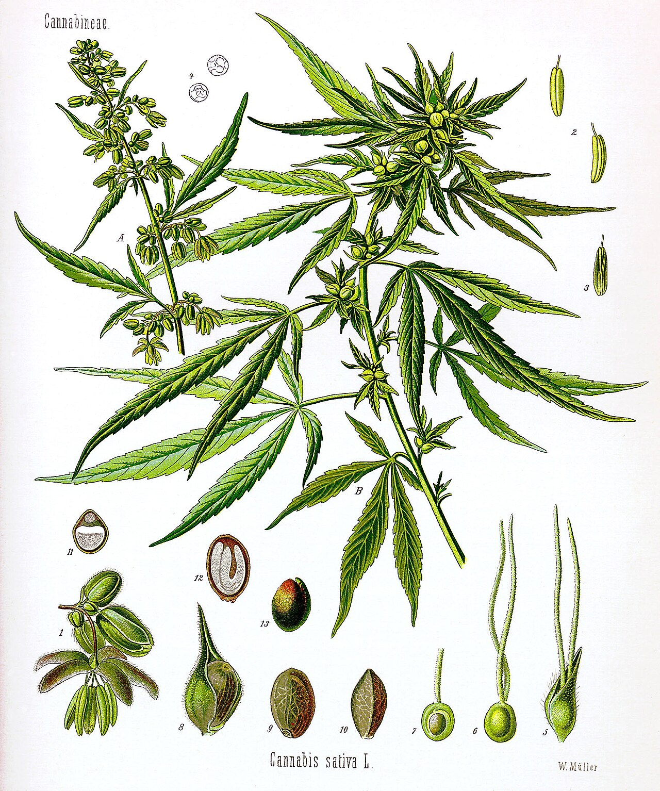

"Indian hemp" was for a century the English name for cannabis as a drug, as against plain hemp, the fibre crop of European fields. It was a doctor's term before it was a lawyer's. Then the British Empire wrote it into the laws of its colonies, the League of Nations wrote it into the first treaty, and a great many countries still use it today, among them Nigeria, which named a whole decree after it.

## Two plants, or one?

To European botanists of the eighteenth century, the hemp grown for rope at home and the drug plant of India looked different enough to be two species. Linnaeus named the first *Cannabis sativa* in 1753. In 1785 Lamarck described the second from Indian specimens and called it *Cannabis indica*, "of India" (see [indica and sativa](/culture/language/indica-and-sativa/)).

In English the drug plant was "Indian hemp". The name said two things at once: that this was the hemp that intoxicated, and that it came from the East.

## A medicine from Calcutta

The name entered Western medicine through one man. [William O'Shaughnessy](/history/india-oshaughnessy-cannabis-tincture-1839/), professor at the medical college in Calcutta, tried preparations of the resin on animals, himself and patients, and from 1839 reported that a tincture was effective against cholera, rheumatism, tetanus and convulsions. On leave in Britain in [1843](/history/uk-doctors-take-up-indian-hemp-1843/) he spoke to a crowded meeting, and doctors took it up.

For the rest of the century "extract of Indian hemp" was a stock item in British and American pharmacies. In [1890](/history/uk-royal-physician-indian-hemp-1890/) the physician to the royal household, J. Russell Reynolds, wrote after thirty years' use that "Indian hemp when pure and administered carefully is one of the most valuable medicines we possess".

## A legal category

In India itself the empire used other words: [bhang](/culture/language/bhang/), [ganja](/culture/language/ganja/), [charas](/culture/language/charas/), and collectively "hemp drugs", as in the [Indian Hemp Drugs Commission](/history/india-hemp-drugs-commission-1894/) of 1894. Outside India, "Indian hemp" became the name of the thing to be controlled.

The turning point was Geneva. At the Second Opium Conference in [1924](/history/geneva-egypt-proposal-1924/) the Egyptian delegate asked that hashish be treated like opium. The [convention of 1925](/history/geneva-opium-convention-1925/) added "Indian hemp" to the substances under international control, the first treaty to cover cannabis at all. Colonial and national laws then copied the term.

| Country | Year | Law using the term |
|---|---|---|
| Soviet Union | [1934](/history/russia-soviet-ban-1934/) | Unauthorised cultivation of "Indian hemp" and the opium poppy prohibited; repeated in Russia's criminal code of [1960](/history/russia-rsfsr-article-225-1960/) |
| Fiji | [1938](/history/fiji-dangerous-drugs-ordinance-1938/) | The Dangerous Drugs Ordinance banned growing and possessing Indian hemp and its seed |
| Bahamas | [1962](/history/bahamas-indian-hemp-definition-1962/) | Indian hemp defined as every part of *Cannabis sativa*, its resin and every preparation |
| Nigeria | [1966](/history/nigeria-indian-hemp-decree-1966/) | The Indian Hemp Decree |
| Comoros | [1995](/history/comoros-penal-code-1995/) | The penal code punishes narcotics, "particularly the hashish or Indian hemp" |

The Bahamas definition shows what had happened to the word. It began as the name of an Indian variety. By 1962 it meant *Cannabis sativa*, every part of it: simply cannabis.

## The Indian Hemp Decree

Nigeria gave the term its harshest form. Months after taking power in 1966, the military government issued a decree under that name that replaced the colonial fines with some of the severest penalties in the world: death for cultivation, twenty-one years for importing. The death penalty was [removed in 1975](/history/nigeria-death-penalty-removed-1975/); penalties were raised again in 1984.

In Nigerian speech the plant has many other names, and the source lists *kaya*, *wee-wee*, *igbo*, *oja*, *gbana*, *blau*, *kpoli*, *kpocha* and *abana*. In court it was Indian hemp.

## The word now

The modern treaties say "cannabis". "Indian hemp" survives in older ordinances and codes, more than a hundred and fifty of which appear in this site's history under that name.
