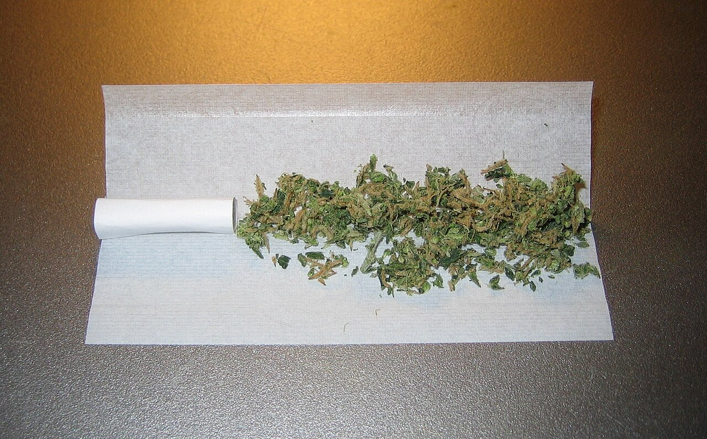

A joint is cannabis rolled in paper and smoked like a cigarette. The word is American slang of the 1930s. Before it meant a cigarette it meant a place, and before that a room.

## From a side room to a cigarette

| Date | Meaning |
|---|---|
| — | French *joint*, "joined", from Latin *iunctus* |
| By 1821 | Anglo-Irish: an annexe, a side room "joined" to a main room |
| By 1877 | American slang: a place or establishment, and especially an opium den |
| 1938 | First recorded for a marijuana cigarette |

How the word passed from the den to the thing smoked is not recorded. The explanation often heard, that it is passed round a joined circle of friends, is a myth.

## What it is

A joint is usually rolled by hand. It holds from a quarter of a gram to a gram of cannabis, sometimes a good deal more. The papers are made of rice, hemp or flax, in many sizes, and where papers are not to hand people use brown paper, an emptied cigarette or beedi, a receipt.

What goes into it differs by region. In Europe a joint made of cannabis alone is uncommon: it usually contains tobacco, because for decades the only cannabis generally available there was imported [hashish](/culture/language/hashish/), which will not burn in paper by itself. The European joint is what Jamaicans and the British call a [spliff](/culture/language/spliff/).

## The vocabulary around it

| Word | Meaning |
|---|---|
| J, jay | Short for joint |
| Doobie | Another word for one |
| Roach | In American and Australian slang, the butt of a mostly smoked joint. In Britain, the rolled cardboard mouthpiece |
| Crutch, filter | The mouthpiece, in North America |
| Roach clip | Anything that holds the last of a joint: a clip, tweezers, forceps |
| Blunt | Cannabis rolled in a cigar wrapper |

## The word in the law

Being slang, *joint* is not a statutory term, but it has been at the centre of famous cases. The American activist John Sinclair was sentenced to ten years in 1969 after giving two joints to an undercover officer, which led to the first [Hash Bash](/culture/traditions/hash-bash/). In Jamaica, the death in custody of a young man [arrested for one joint](/history/jamaica-death-in-custody-reform-push-2014/) pushed the country to its reform of 2015.
