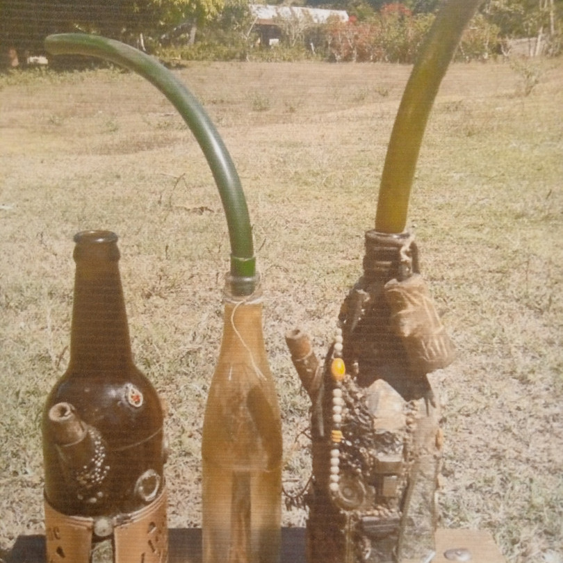

*Rongony* is the Malagasy word for cannabis. It names the plant, especially when grown for fibre, and the leaves and flowers that are smoked; Malagasy dictionaries give it as the general word, and the island's laws used it from 1915 until 1997.[@1,2,3,17]

Its history runs through textile work, proverbs, the Merina monarchy's attempts to control smoking, and the French colony's decision to write *rongony* into law. The sources do not establish a single origin: the most specific proposal connects it to *rongo*, a term for woven cloth and textile fibre, but that derivation is offered by a botanical dictionary rather than demonstrated. The vocabulary was regional, and only some names entered the statute book.[@3,4]

## Fibre, cloth and the root rongo

The *Dictionnaire des noms malgaches de végétaux* (1999) labels *rongony* a Merina and Betsileo word and derives it from *rongo*: "ce que l'on tisse; les fibres textiles", what is woven, textile fibres.[@3] *Rongo* can mean textile fibre; a Sakalava sense may be a fibre-bearing tree.[@4] The link is plausible, but the entry gives no older form, sound change or cognate to prove it: the best etymology found, not a settled one.[@3,4]

Fibre use is documented. Chris Duvall writes that late nineteenth-century Malagasy people made hemp fabric and had an extensive vocabulary for fibre processing, and that *rongony* named both the plant generally and plants grown for fibre.[@5] The dictionaries agree; Malagasy Wiktionary adds that the name was also given to other weaving plants.[@2,3]

The fibre entered the proverb tradition. *Manan-karena salasala, ka manao kitamby rongony* — "neither rich nor poor: one wears a hemp wrap" — was explained by Houlder as a reference to hemp cloth marking the middle condition.[@7,8,9] Another compares people who wait to stink before joining together to hemp in retting, the soaking that separates the fibres: *Aza mantsim-bao miray, hoatry ny rongony.*[@7,8]

, no. 2439. English from the French translation. This is a modern design, not a historical document. | Cannabis Freedom Index, from the proverb as recorded by Malagasy Word | https://malagasyworld.org/bins/ohabolana/rongony")

## The plant and its many names

Other names were regional.[@3,10,11,12]

| Name | Recorded in | What it names |
|---|---|---|
| rongony | Merina and Betsileo; the general word | the plant, especially grown for fibre; also the drug |
| angafo | Merina | the smoked tops; *manangafo*, to smoke hemp |
| jiajia | Sakalava and Tankarana | young leaves and tops; Anjiajia, "where there is hashish" |
| jamala | Bara, Tanosy, Betsimisaraka and Taisaka | cannabis and its smoked tops; also impatience |

*Maosy* is a Betsimisaraka familiar name for the tops; *katrinia* is leaves and seeds mixed with sugar and smoked.[@13,14]

These names were not interchangeable: *rongony* named the fibre plant, while *angafo* and *jiajia* named the parts prepared as a drug. But *rongony* was also the general and legal word, which is why the 1915 decree could prohibit "chanvre à fumer dit Rongony" without naming *angafo*.[@3,15]

Duvall adds older names — *ahetsmanga*, *jía*, *soróma* — whose distribution suggests links with the African mainland; he keeps them distinct from *rongony*.[@5] The plant drug was first documented in [Flacourt's history of 1661](/history/madagascar-flacourt-first-documentation-1661/). *Jamala* travelled: Robert Drury recorded it in 1729, and Jean Benoist traced [Réunion's *zamal*](/culture/language/zamal/) to it, a journey recorded in [the history of the word](/history/reunion-zamal-malagasy-roots-1729/).[@5,6,12]

## A word in the statute book

The best-known prohibition story is royal. *Fon' ny mpifoka rongony* — "the heart of a hemp smoker is cruel" — is recorded as a proverb, and the collector's note says King [Andrianampoinimerina, conventionally in 1787](/history/madagascar-merina-ban-1787/), made smoking a capital offence, though the law was soon abandoned.[@8] The 1967 note is retrospective. Duvall dates the ban to 1870 or earlier, citing European accounts; the botanical dictionary attributes the ban and a cultivation prohibition to Prime Minister Rainilaiarivony.[@5,12] Duvall says the ban spared fibre production; the proverb note presents it as anti-smoking.[@5,8]

The French colony made the word a legal term. A [decree of 9 October 1915](/history/madagascar-colonial-rongony-ban-1915/) prohibited "the preparation, peddling, sale and consumption of smoking hemp known as Rongony" throughout Madagascar and its dependencies. The title and Article 1 both used the Malagasy word; Article 2 set the penalties.[@15] The offence was smoking hemp, not hemp fibre.

. | Decalog / ENAP digital collection | https://data.decalog.net/enap1/Liens/fonds/F10E4.PDF")

Independence kept the word. In July 1960 President Tsiranana's government replaced the colonial rules with [Ordinance 60-073](/history/madagascar-rongony-penalties-raised-1960/), "relative à la répression du trafic de chanvre /cannabis/ dit rongony". It banned cultivation and raised the maximum to five years and a 1,000,000-franc fine; the government said colonial penalties had failed.[@16]

In 1997 [Law 97-039](/history/madagascar-drug-law-1997/) prohibited "the cultivation of the opium poppy, the coca bush and the cannabis plant" and used *cannabis* rather than *chanvre* or *rongony*.[@17] Article 148 repealed the 1960 ordinance, which it called "relative à la répression de la consommation du chanvre indien dit rongony" — a law about consumption, though its title was about traffic. The word survived only in the repeal clause.

## The word today

The law stopped saying *rongony*; people did not. The [Global Initiative Against Transnational Organized Crime](https://globalinitiative.net/) reported in 2021 that Madagascar was the most significant cannabis producer among the western Indian Ocean islands, with major production in Analabe and Betroka and exports across the Indian Ocean.[@18] In Analabe Ambanja, residents demonstrated how cannabis oil is inhaled through a bottle.[@18]

The double meaning still shapes how the plant is seen. A 2023 master's thesis at the [Rhode Island School of Design](https://www.risd.edu/) argues that because hemp and marijuana are both called *rongony*, the fibre's heritage carries the drug's stigma; its author, Henintsoa Thierry Andrianambinina, calls hemp "highly taboo" in Madagascar and traces the association to colonial prohibition.[@19,20] That is a designer's argument about the present, not a history of the word.
