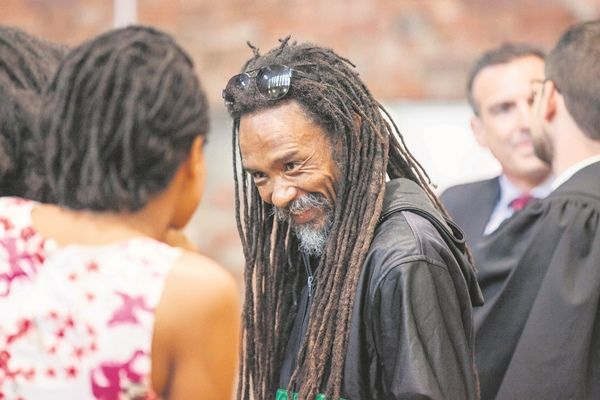

Garreth Anver Prince is a Rastafari law graduate from Cape Town whose attempt to become an attorney began a decades-long legal fight over cannabis in [South Africa](/country/za/). Court records use Garreth; many newspapers print Gareth.[@4,5,8] The Cape Law Society refused to register his community-service contract because of two cannabis convictions and his intention to keep using the plant as a Rastafari. He lost his religious-freedom claim in 2002, then won a privacy case in 2018.[@4,5]

The same facts failed as a religious claim but succeeded as a privacy claim. Yet 2018 was not the end: the Cannabis for Private Purposes Act was still not in force in 2026, and Prince was back in court over arrests, plant destruction and the exclusion of traditional growers.[@9,14,15]

## A choice between faith and career

Prince completed the academic requirements for admission as an attorney.[@1] The Law Society had to find him “a fit and proper person”. He disclosed two cannabis convictions and said he would keep using the plant as a Rastafari. The society refused, so he had to choose between his faith and his career.[@1,4]

His case described cannabis smoked through a chalice, burnt as incense and used at home to bathe in, drink and eat; there were then about 12,000 Rastafari.[@4]

## Five votes to four

The Cape High Court and the Supreme Court of Appeal had already dismissed his challenge.[@1] On [25 January 2002](/history/south-africa-prince-law-society-2002/) the Constitutional Court ruled against him by five votes to four. The majority accepted that the ban limited Rastafari religious rights but held it justified: there was “no objective way” for police to tell religious use from any other.[@4]

Four judges dissented. Justice Albie Sachs wrote that the Constitution obliges the state “to walk the extra mile”.[@4]

## Africa and the United Nations

Abroad, the African Commission found [no violation](/history/south-africa-prince-african-commission-2004/) in 2004, saying the government was “better placed” to judge. Prince said he wanted “a reasonable accommodation”, not decriminalisation.[@2,3] On [31 October 2007](/history/south-africa-prince-un-committee-2007/) the UN Human Rights Committee found no breach. It accepted that cannabis was essential to the religion, but said an exemption would need an import and distribution system that could leak into general circulation.[@1]

## From religion to privacy

He returned to court with a claim that did not depend on faith. With Jeremy Acton of the [Dagga Party](/history/south-africa-dagga-party-2009/) and Jonathan Rubin, he argued that the ban on private use and cultivation violated the right to privacy. The Western Cape High Court agreed [in March 2017](/history/south-africa-western-cape-2017/).[@5,6]

On [18 September 2018](/history/south-africa-constitutional-court-2018/) the Constitutional Court confirmed the ruling in a unanimous judgment by Acting Chief Justice Raymond Zondo. Criminalising adults’ private possession, use or cultivation for personal consumption was unconstitutional. Parliament was given 24 months; adults could use, possess and grow cannabis in private.[@5]

The ruling covered every adult in private, Rastafari or not. Buying and selling stayed illegal, and use in public or around children was not permitted.[@5] Prince called the decision “a vindication for the Rastafarian community, the cannabis community, as well as for myself”.[@7]

## Two cases, two claims

The 2002 case asked for a religious exemption; the 2018 case asked for privacy. The orders show the difference.[@4,5]

| 2002 — Religious freedom claim unsuccessful | 2018 — Privacy claim successful |
|---|---|
| **Prince v President of the Law Society** (CCT 36/00), 2002 | **Minister of Justice v Prince** (CCT 108/17), 2018 |
| Claim: a religious exemption for Rastafari use. | Claim: privacy for adults using cannabis privately. |
| Order: “The appeal is dismissed.” | Order: the ban is invalid “to the extent that [it makes] the use or possession of cannabis in private by an adult ... a criminal offence.” |

## What the law changed

Parliament’s answer, the [Cannabis for Private Purposes Act](/history/south-africa-private-purposes-act-2024/), was signed in May 2024. It provides for private use, possession, cultivation and transport, but it starts only on a date set by presidential proclamation. By October 2026 it had still not commenced. Draft regulations published in February 2026 proposed limits of 750 grams and five plants; they were not final.[@14,15,16]

## Back to court in 2026

In April 2026 Prince, the RasTafari Nation Council and small-scale farmers brought an urgent Western Cape High Court application. They sought relief against arrests, plant destruction and the exclusion of traditional growers, and challenged the Act and Hemp Regulations.[@9]

State ministries arrived without answering papers. Acting Judge Mnengwana refused, set a timetable and ordered the case back on 8 June.[@9] It was postponed to July; on 31 July the court directed the parties to seek a settlement.[@10,11]

Prince’s notice said a court-directed interdepartmental meeting would be held at the Department of Trade, Industry and Competition on 14–15 September. A report described departments meeting on 15–16 September, with a response due by 1 October.[@11] The talks were not a ruling. By mid-October the department had not published an account and state lawyers had sought more time.[@12]

The government is separately seeking legal pathways to formalise indigenous growers.[@13] Prince’s application argues that the Act was wrongly tagged as a section 75 bill, that public participation was defective, and that it creates a right to use cannabis without a lawful source of supply.[@10] Those claims have not been decided.

The Act remains uncommenced.[@14,15]
