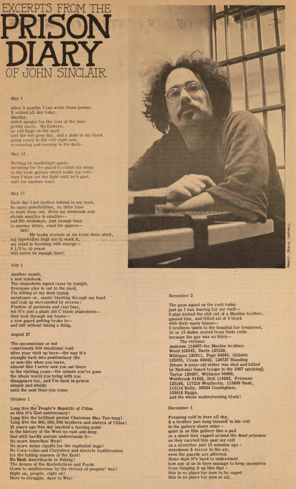
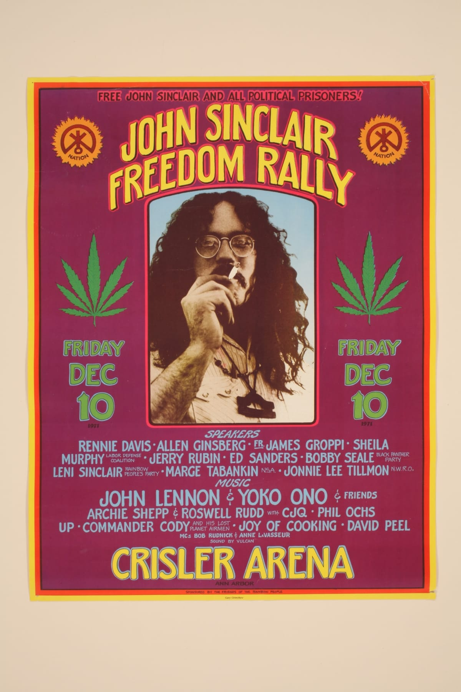

John Sinclair was a Detroit poet, jazz critic and manager of the [MC5](https://en.wikipedia.org/wiki/MC5) who became a national cause in the [United States](/country/us/) after a [Michigan](/country/us/mi/) court sentenced him to nine and a half to ten years for possessing two marijuana cigarettes.[@1,5] The campaign to free him filled Crisler Arena in Ann Arbor in December 1971.[@2] The release on bail and the court that reversed his conviction were separate from the concert.[@1,2,4]

The case showed how heavily a state could punish a small amount of cannabis, and it turned a private arrest into a public argument about prohibition.[@1,2] It also left a record of the punishment in the prison diary Sinclair wrote while inside.[@3]

## Poet, manager, Panther

Sinclair was born in Flint, Michigan, on 2 October 1941.[@5] In Detroit he wrote poetry and jazz criticism, helped run the Artists' Workshop, and wrote for the underground paper [Fifth Estate](https://en.wikipedia.org/wiki/Fifth_Estate_(periodical)).[@5,10] In 1966 he began managing the MC5, the Detroit rock band whose loud, politically charged shows made them a symbol of the city's counterculture; he managed them until 1969.[@5,10]

In 1968 he founded the [White Panther Party](https://en.wikipedia.org/wiki/White_Panther_Party) with Pun Plamondon, a white radical group conceived as a counterpart to the Black Panther Party.[@5] He treated the cannabis charges as political. "I was part of the revolution," he said later, "and that's what authoritarian states do to revolutionaries. So it was part of my job."[@10]

## Ten years for two joints

The case began on 22 December 1966, in the flat above the Artists' Workshop in Detroit. Sinclair rolled two marijuana cigarettes and gave them to two undercover police officers who had been working their way into the Workshop.[@1] He was arrested on 24 January 1967 and charged with sale and possession.[@1]

The sale count was dismissed on entrapment grounds before trial. A jury convicted him of possession on 25 July 1969, and on [28 July 1969](/history/us-sinclair-sentence-1969/) Judge Robert Colombo sentenced him to nine and a half to ten years.[@1] Michigan then classified marijuana as a narcotic, and Sinclair's lawyers had spent two and a half years challenging that classification while he was free on bond.[@1] He was taken to prison the same day.[@4]

In prison he kept writing. On 30 April 1971 the [Ann Arbor Sun](https://aadl.org/papers/aa_sun) printed excerpts from his prison diary, with a photograph by Craig Carrell of Sinclair at a typewriter in front of the bars.[@3]

"My mind is bursting with energy — 9 1/2 to 10 years will never be enough time!" he wrote in an entry dated 17 May.[@3] The page shows him as a writer inside the sentence, not only as a defendant outside it.[@3]

## The rally and the release

The campaign began before the concert. In January 1970 a Free John Sinclair rally at Detroit's Grand Ballroom featured the MC5, the Stooges and speakers including Abbie Hoffman.[@11]

On [10 December 1971](/history/us-john-sinclair-freedom-rally-1971/) the John Sinclair Freedom Rally filled [Crisler Arena](https://en.wikipedia.org/wiki/Crisler_Center) for an eight-hour bill of music and speeches.[@2] [John Lennon](/culture/people/john-lennon/) and Yoko Ono headlined, with Stevie Wonder, Phil Ochs, Bob Seger, Archie Shepp, Bobby Seale, Allen Ginsberg and Jerry Rubin.[@2] Lennon performed "John Sinclair", the song he had written for the occasion and later released on [*Some Time in New York City*](https://en.wikipedia.org/wiki/Some_Time_in_New_York_City).[@2,5] Sinclair spoke to the arena by telephone from Jackson prison.[@4]

Gary Grimshaw's poster put Sinclair's face between cannabis leaves and the names of the performers and speakers, with the words "Free John Sinclair and all political prisoners" above them.[@9]

The release had its own legal history. The Michigan Senate had voted on 9 December, the day before the concert, to reduce penalties for possession, and on 13 December the Michigan Court of Appeals granted bail pending appeal.[@2,4] Sinclair left Jackson that evening, three days after the concert, having served twenty-nine months. His conviction was still on appeal.[@4] The concert made the case visible; the release came through the courts.[@2,4]

## The ruling and Hash Bash

On [9 March 1972](/history/us-sinclair-conviction-reversed-1972/) the Michigan Supreme Court reversed the conviction and ordered Sinclair discharged.[@1] Justice Swainson's opinion held that the statute's classification of marijuana with hard narcotics violated the equal protection clauses of the state and federal constitutions.[@1] The ruling struck at the classification, not at the prohibition. Prosecutions could continue under a misdemeanour statute until the state's new controlled-substances law took effect on 1 April 1972.[@1]

On 1 April 1972 the first [Hash Bash](/culture/traditions/hash-bash/) gathered on the University of Michigan's Diag. It began as a response to the ruling, on the day the new law took effect, and it has met every year since.[@6] Ann Arbor went further than the state. [In 1972 the city council set a $5 fine for use, possession or sale](/history/us-ann-arbor-five-dollar-fine-1972/), and in 1974 voters wrote the civil-infraction penalty into the city charter.[@7] The campus remained under state law, which is why open smoking at Hash Bash was a deliberate act of civil disobedience.[@6]

## Later life

Sinclair returned to Ann Arbor, chaired the Rainbow People's Party, and went on writing and performing.[@4,5] He moved to Amsterdam, founded the John Sinclair Foundation in 2004, and hosted a radio show there; he also worked as a disc jockey in New Orleans.[@5]

Michigan changed its law slowly. Voters approved [medical cannabis in 2008](/history/us-michigan-medical-cannabis-2008/) and [adult use in 2018](/history/us-michigan-adult-cannabis-2018/), and legal sales began on 1 December 2019.[@8] Sinclair was among the first customers.[@5]

He died in Detroit on 2 April 2024.[@5] The Hash Bash that year was held in his memory, and its speakers still called for legalisation at the federal level.[@5,6]
