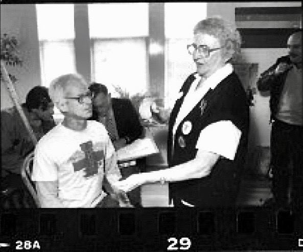
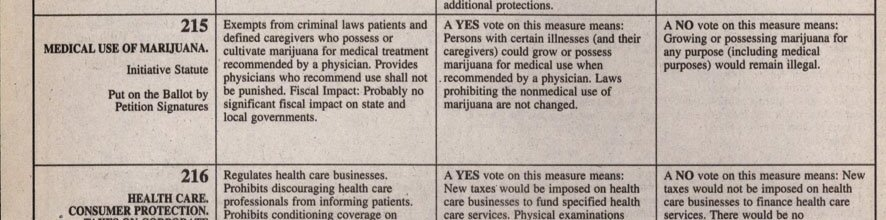

Tod Mikuriya was a Berkeley psychiatrist who spent his career arguing that cannabis was a medicine American doctors had forgotten. He recovered nineteenth- and early twentieth-century clinical papers, interviewed patients at San Francisco’s Cannabis Buyers’ Club, and helped draft California’s 1996 medical-cannabis law. He is often called the grandfather of the medical-cannabis movement in the [United States](/country/us/).[@1,2,8]

His work joined three roles: historian, physician and reformer. It also showed the limits of his evidence. His 1995 study recorded what patients said cannabis did for them, not what controlled trials proved. And his willingness to recommend cannabis brought him before the Medical Board of California.[@1,4,9]

## The forgotten papers

Born in Pennsylvania in 1933, Mikuriya studied psychology at Reed College, served as a neuropsychiatric medic in the US Army, and qualified in medicine at Temple University in 1962. He found cannabis in a pharmacology book in 1959.[@9,11]

In 1967 he joined the National Institute of Mental Health’s Center for Narcotics and Drug Abuse Studies, in charge of non-classified marijuana research. He left after about two months, by his own account because the agency was not interested in the drug’s possible uses, and opened a private practice in Berkeley.[@1,2,11]

His answer was to recover what had been done before prohibition. He collected clinical papers and bibliographies from the National Library of Medicine and from archives and libraries abroad. In 1973 he published them himself through Medi-comp Press as *Marijuana: Medical Papers, 1839–1972*.[@1,3] The 1972 in the title marks the last year of the literature he collected, not the year of publication.[@3] His papers at the [National Library of Medicine](https://findingaids.nlm.nih.gov/repositories/4/resources/957) fill 137 boxes.[@1,2]

## Listening to patients

The book made him a resource for doctors and activists. At the San Francisco Cannabis Buyers’ Club, run by [Dennis Peron](/culture/people/dennis-peron/) with [Brownie Mary](/culture/people/brownie-mary/) a familiar presence, Mikuriya set up a table and interviewed members about their use.[@1,4]

In 1995 he wrote up 57 interviews, 51 with men and 41 with people who had HIV. Using a structured questionnaire, he recorded the symptoms patients said cannabis relieved: insomnia, depression, anxiety, panic attacks, arthritis and other pain, alcoholism.[@4] The manuscript was never published in his lifetime; it survives in his papers.[@4]

The study treated patients as witnesses to their own experience when mainstream medicine offered little guidance. It was not a controlled trial. It did not compare cannabis with placebo or standard treatment, and could not show that cannabis caused the relief. It mapped what people used and why, the evidence the medical-cannabis campaign needed.[@4]

## Proposition 215

In 1996 Mikuriya campaigned for and helped draft Proposition 215, the [Compassionate Use Act](/history/us-california-medical-1996/), with Peron and others.[@1,6,8] It protected patients whose doctor found cannabis would help them, including through a catch-all clause.[@5]

*Modern typeset reproduction of the original statutory text:*

> “... the use of marijuana in the treatment of cancer, anorexia, AIDS, chronic pain, spasticity, glaucoma, arthritis, migraine, or any other illness for which marijuana provides relief.”[@5]

Mikuriya was long credited with the catch-all.[@8] Dale Gieringer, another principal author of the initiative, has cautioned that Mikuriya may not have written that sentence himself, though his study of Buyers’ Club members supplied the evidence for it.[@4] The attribution is disputed; the clause’s open-endedness is not.[@4,5,6]

The same measure promised that “no physician in this state shall be punished” for recommending cannabis.[@5] Washington answered within weeks, [threatening doctors who did so](/history/us-federal-warning-doctors-1996/); the courts later [protected their right to discuss and recommend it](/history/us-conant-physician-recommendations-2002/).

## The medical board

After 1996 he saw patients from home and estimated that he recommended cannabis to about 9,000 people.[@8] In 2000 the [Medical Board of California](https://www.mbc.ca.gov/) accused him of gross negligence, unprofessional conduct and incompetence for recommending cannabis without properly examining patients.[@9] O’Shaughnessy’s reported that the accusation covered 46 cases.[@6]

In 2004 the board imposed five years’ probation and a $75,000 fine. Mikuriya appealed and continued to practise under a state-appointed supervisor.[@9] The board’s stated case was about the standard of care: his assessments were inadequate. His supporters said none of the cases began with a patient complaint; the complaints came from police, sheriffs and prosecutors who resented his approvals.[@6,7] Both belong in the record: the board disciplined him, and the case unfolded in a political conflict over whether doctors could recommend cannabis at all.[@1,6,9]

## Legacy

In 1999 he founded the California Cannabis Research Medical Group and the [Society of Cannabis Clinicians](https://www.cannabisclinicians.org/tod-mikuriya-founder/).[@1,2,10,11] He also urged the creation of [O’Shaughnessy’s](https://www.cannabisclinicians.org/resources/oshaughnessys/), the clinical journal launched in 2003 and named for [William O’Shaughnessy](/culture/people/william-oshaughnessy/).[@7]

In 2006 NORML gave him its [Lester Grinspoon](/culture/people/lester-grinspoon/) Award for his work on marijuana law reform.[@8] He died at his home in Berkeley on 20 May 2007, aged 73, of cancer.[@9,11]

His papers are held at the National Library of Medicine, where the interviews, correspondence and drafts behind that work survive.[@1,2]
