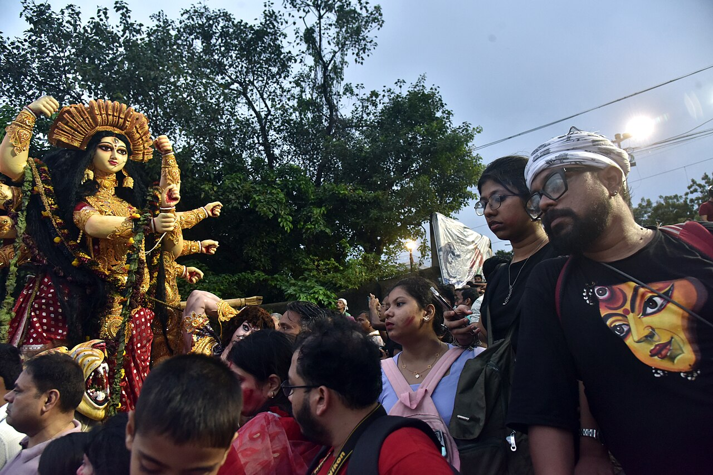

Bijoya Dashami is the last day of Durga Puja, the great autumn festival of Bengal. The images of the goddess are carried to the river and immersed; then people embrace, touch the feet of their elders, and spend the following days visiting one another with sweets. In the 1890s, in much of Bengal, the host's hospitality on that day included a cup of bhang, the drink made from cannabis leaves.

The custom is known from one detailed account: the evidence of a Bengali excise officer to the [Indian Hemp Drugs Commission](/history/india-hemp-drugs-commission-1894/) of 1893–94. It is less famous than [bhang at Holi](/culture/traditions/bhang-at-holi/), and no source read for this entry says whether households still keep it.

## What the commission was told

The witness was Abhilas Chandra Mukerjee, a Brahmin deputy magistrate serving as Second Inspector of Excise for Bengal. He had earlier run the excise at Rajshahi and supervised the government ganja tract at Naogaon. Asked about social customs, he answered that bhang drinking was part of "festive occasions" such as Bijoya Dasami, after the images had been thrown into the water.

The leaves, he said, were ground with black pepper and spices and mixed with milk, sugar and water or coconut water. The mistress of the house gave a cup to every member of the household and to every person who came to pay respects. He compared it to "drinking health" in European society. In central and northern Bengal, after the Bijoya embraces, it was the duty of the host to offer each visitor bhang and sweetmeats.

He described more than one day and more than one district:

| Occasion | Where | What was done |
|---|---|---|
| Bijoya Dashami, after the immersion | Central and northern Bengal | A cup of bhang with sweets for every visitor |
| Bijoya Dashami, at the immersion | Dacca district | *Satabari*, balls of rice flour, bhang and cane sugar, sold to the crowds at the river |
| Maha Navami, the day before | Mymensingh and the eastern districts | Bhang offered to Shiva, then shared |
| Maha Navami | Dacca district | Young and old drank before the image of Durga; the priest poured it into each mouth |
| Lakshmi Puja, Saraswati Puja | Eastern Bengal | Bhang offered and drunk, or fried leaves offered to Saraswati |

He called the use temperate and said that bhang drinkers were not looked down on, unlike ganja smokers, whom the gentry despised. Mymensingh and Dacca are now in Bangladesh.

## The victorious

The festival's name means "the tenth day of victory": in Bengal it celebrates Durga's defeat of the buffalo demon Mahishasura. In Sanskrit one of the oldest names of hemp is *vijayā*, "the victorious". The scholar George Grierson, writing for the same commission, found it in an eleventh-century medical vocabulary beside *bhangā* and *indrāsana*, "Indra's food", and quoted a verse explaining that it was called victorious because it gives victory in the three worlds. J. M. Campbell's note in the same report gives a different reason: bhang was the unbeaten one because it drove off the spirits of fear, which is why Rajput warriors drank it before battle.

Grierson also recorded *siddhi*, "success", as a name for bhang, in a Hindi poem that puns on the word. None of the sources read for this entry says whether Bengalis linked the drink at Bijoya to these names. The coincidence is noted here as a coincidence.

## What the law did

The commission concluded that moderate use of hemp drugs did little harm, and the colonial excise went on taxing and licensing them. When the world drug treaty was written in 1961, India [kept the leaves out of its definition of cannabis](/history/india-bhang-exemption-1961/), so that bhang could go on being drunk. The [1985 narcotics act](/history/india-ndps-act-1985/) banned flower and resin but left the leaf alone, which is why bhang is still legal. In Kolkata today, bhang is sold in sherbet shops, in drinks and in small balls.

The eastern districts that Mukerjee described went another way. Bangladesh [banned cannabis outright in 1989](/history/bangladesh-ban-1989/).

## Bijoya now

Present-day descriptions of Bijoya in Kolkata give the same order of events as in 1894: the immersion, the greeting *Shubho Bijoya*, touching elders' feet, the triple embrace called *kolakuli*, and visits in the days after, rewarded with tea, snacks and sweets. The ones read for this entry do not mention bhang. That is not proof that the cup has gone from every house, but it means that the custom can be documented for the 1890s and not, from these sources, for today.
