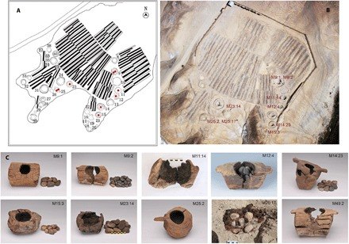

In Xinjiang, in [China](/country/cn/)’s far west, archaeologists have found cannabis in first-millennium BCE graves. Yanghai held a basket and bowl of plant material; Jiayi held thirteen nearly complete plants across a man’s body. At Jirzankal, wooden braziers preserved residues of burnt cannabis.

These are physical finds, distinct from written accounts such as Herodotus’ description of the [Scythians](/culture/traditions/the-scythian-vapour-bath/). They reveal materials placed with the dead, while beliefs and purposes require interpretation.

## Three cemeteries

| Site | Where | Age | What was found | Published |
|---|---|---|---|---|
| Yanghai, tomb M90 | Turpan basin, near the Flaming Mountains | About 2,700 years | 789 g of ground plant in a leather basket and a wooden bowl | [2008](/history/china-yanghai-cannabis-study-2008/), *Journal of Experimental Botany* |
| Jiayi, tomb M231 | Turpan basin | 2,800 to 2,400 years | Thirteen nearly whole plants laid over the body | [2016](/history/china-jiayi-cannabis-shroud-2016/), *Economic Botany* |
| Jirzankal | Tashkurgan, eastern Pamirs, about 3,000 m up | About 2,500 years | Ten wooden braziers in eight tombs, with burnt stones | [2019](/history/china-jirzankal-study-2019/), *Science Advances* |

## The basket at Yanghai

The man in tomb M90 at Yanghai was about 45 and of high standing. He was buried with bridles, archery gear and a harp, which led the excavators to call him a shaman; that is their reading of the grave goods, not something written on it. The tomb was first dated by radiocarbon to about 2,500 years ago and later to about 2,700, from the horse gear and tree rings.

Near his head and feet lay a leather basket and a wooden bowl holding 789 grams of loose, dry, lightly pounded plant matter. It was first taken for coriander. Under the microscope it was cannabis. The team, which included the cannabis researcher Ethan Russo, found cannabinol, the substance THC turns into as it ages, as the largest trace, and the gene for the enzyme that makes THC. The plant had been a drug type, not a fibre hemp. The seeds were present but dead, and there were no obvious male parts, which the authors thought might have been picked out on purpose.

How the man or his people took it is unknown. No pipe or brazier was found with it. The authors concluded that it was probably grown for psychoactive, medicinal or divinatory use, and left the choice open.

## A shroud of whole plants

[Jiang and colleagues’ study](https://link.springer.com/article/10.1007/s12231-016-9351-1) associates Jiayi with the Subeixi culture in the Turpan Basin. Radiocarbon dating places the burial approximately 2,800–2,400 years ago. One of its 240 graves held a man of about 35, his head on a reed pillow. Thirteen cannabis plants, nearly whole, had been laid diagonally across his chest, their roots under his pelvis and their tops reaching up beside his face.

The flower heads were almost ripe, so the burial probably took place in late summer, and the plants seem to have been grown nearby. The team led by Hongen Jiang noted that no hemp cloth had been found in the Turpan burials and that the seeds were too small to be worth eating. Their conclusion was ritual or medicinal use, perhaps both.

## Smoke at the graveside

Jirzankal lies on the Tashkurgan river in the Pamirs, a passage between China, Central Asia and south-west Asia. Its tombs contained glass beads, silk and angular harps. Ten wooden braziers came from eight of them, holding stones blackened by fire. When chemists tested the charred insides, nine of the ten carried traces of cannabis, and so did two of the stones. The outsides, used as a control, carried none. The residue was richer in the products of THC than wild plants usually are, which suggests that stronger plants were chosen, or that the mountains produced them.

The authors read the braziers as part of the funeral itself: hot stones laid on cannabis, the smoke breathed by the mourners, and music. They pictured rites with "flames, rhythmic music, and hallucinogen smoke". Some skulls were pierced and some bones cut, which the excavators took for human sacrifice; the paper says this still needs checking. Herodotus places the Scythian smoke after the burial, as a cleansing. At Jirzankal it seems to have been part of the burial.

## What the graves leave out

None of the three sites tells us what the plant meant. The words "shaman" and "ritual" are inferences from grave goods. The chemistry shows that the plants were drug types, not how much anyone felt, how often the living used them, or whether the custom reached beyond a few families of rank. The three finds also come from different communities: the Turpan graves from oasis people, Jirzankal from a mountain cemetery where ten of the 34 people tested had grown up elsewhere.

The region later retained its association with cannabis. Xinjiang's hashish was exported legally to British India under a tariff until [China ended the trade in 1934](/history/china-xinjiang-hashish-trade-ended-1934/). Since [1985](/history/china-narcotic-1985/) China has listed cannabis as a narcotic, while hemp for fibre and seed is still grown.
