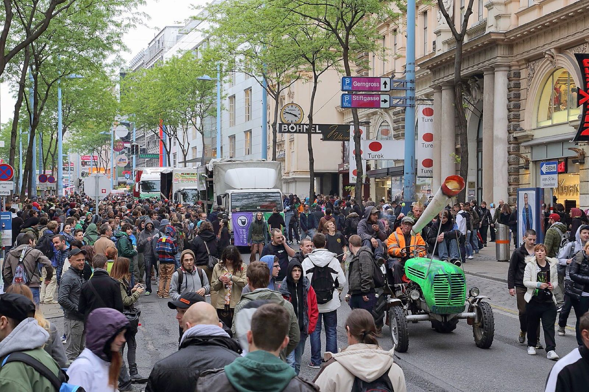

On the first Saturday of May, people in hundreds of cities march for the legalisation of cannabis. The Global Marijuana March [began in 1999](/history/global-marijuana-march-1999/) and has been held in more than a thousand cities in 85 countries and territories. In some of them the march is a festival. In others the right to hold it at all has had to be won in court.

## One day, many names

The march began as a coordinated version of rallies that already existed, New York's among them. At that first worldwide march in 1999 the New York police counted 4,000 people and the organisers 20,000.

| Name | Where |
|---|---|
| Global Marijuana March, Million Marijuana March | The general names |
| Marcha da Maconha | Brazil |
| Marche Mondiale pour le Cannabis | France: Paris, Lyon, Toulouse, Marseille and other cities |
| Hanfwandertag | Vienna |
| J Day | New Zealand |
| Marijuana March Tokyo | Tokyo, yearly since 2001 |
| Cannabis Liberation Day, Ganja Day, World Cannabis Day | Used locally |

## What happens

The form is the same everywhere: a gathering, a march through the centre, then speeches and music.

- In **Toronto** the rally at Queen's Park has been held since 1999. Police estimated 12,000 people in 2009, and a newspaper reported 25,000 in 2011.
- In **Vancouver** the crowd meets at the fountain of the Art Gallery and parades through downtown by a route that changes every year.
- In **Copenhagen** the march sets out from Christiania and ends at the city hall square. Smoking cannabis is illegal in Denmark, but during the march the police do not enforce the rule.
- In **Dunedin**, New Zealand, J Day in 2003 ended with about fifty people walking into the central police station, planting cannabis in the foyer and smoking there. Nobody was arrested, and they did it again the next year.

## Where marching was a crime

In Brazil the march ran into the offence of *apologia*, the advocacy of a crime. Judges in several cities banned the [Marcha da Maconha](/culture/traditions/marcha-da-maconha/) on that ground.

The question went to the Supreme Court in 2009. On 15 June 2011 the ministers ruled unanimously that a demonstration for the legalisation of a drug is an exercise of freedom of expression and not incitement to commit a crime. The same offence had been used to jail the band [Planet Hemp](/history/brazil-planet-hemp-arrest-1997/) fourteen years earlier.

Germany has a yearly march of its own, the [Hanfparade](/history/germany-hanfparade-1997/) in Berlin, held every August since 1997.

## Why it lasts

The march repeats whatever the state of the law. Where cannabis has been legalised it turns into a celebration; elsewhere it remains a protest.

It shares that form with [Hash Bash](/culture/traditions/hash-bash/), which is older, and with the gatherings of [20 April](/culture/language/420/).
