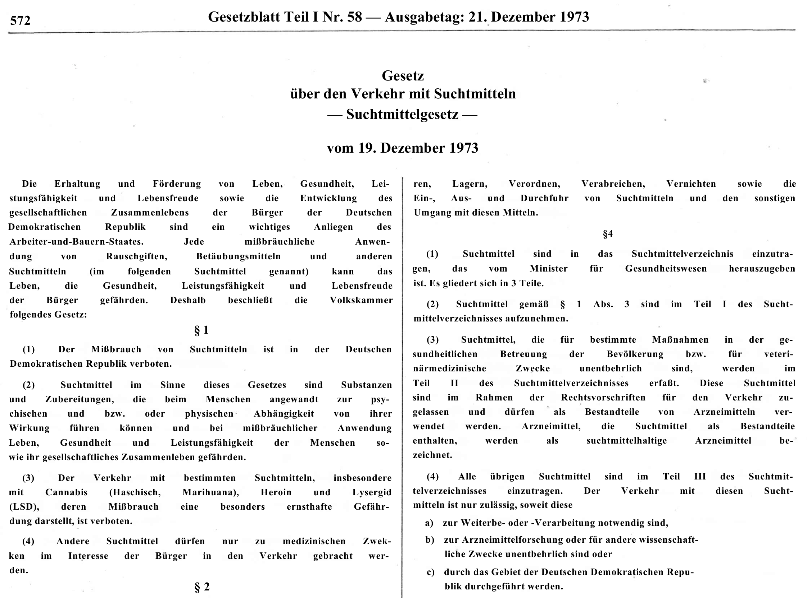

In divided Germany, hashish smoking meant opposite things on either side of the border. In West Germany around 1968, a pipe of *Hasch*, the everyday German shortening of *Haschisch* ([hashish](/culture/language/hashish/)), was passed around communes and student circles as a sign of fellowship and refusal of bourgeois life. In the German Democratic Republic (GDR, *DDR*), the ruling party read the same habit as proof of capitalist decay, and hashish arrived mostly as cargo crossing its territory towards West Berlin.

Duden records the neuter *das Hasch* and *Hascher*, a masculine word for someone who smokes hashish. The words were shared across the border, but what people thought smoking meant was not.

## Hasch and Hascher

The shortening makes a longer product name part of informal speech. *Hascher* shifts attention from the substance to the person using it. In a newspaper headline, that label could identify a whole social type rather than describe an individual act.

The dictionary establishes those meanings, not a first-use date. The dated newspaper examples examined here document circulation by 1970; they do not establish when German speakers first shortened the word or who invented it.

## A pipe in the student movement

Historian Ned Richardson-Little describes the hashish pipe as a visible symbol among sections of West Germany's extra-parliamentary opposition in 1968. Passing cannabis around could express sharing, fellowship and rejection of bourgeois conventions. Some commune participants understood intoxication as part of building a different kind of social life.

That interpretation was contested even on the Left. East Germany's ruling Socialist Unity Party valued political discipline and rejected the claim that intoxication advanced socialism. In the historian's account, the party's press portrayed the drug scene as a diversion from organised political work.

These were competing political readings of consumption. They do not mean every student activist smoked or that every smoker belonged to a radical organisation.

## Haschers and Marx

On [October 27, 1970](/history/germany-gdr-hashers-capital-1970/), *Neues Deutschland* published Günter Böhme's article under a headline Richardson-Little translates as “Hashers don't read Das Kapital.” It presented Western drug culture as a threat to political engagement, rather than a route towards emancipation.

The historian notes that the phrase originated in the West German magazine *konkret*. Its reuse illustrates how an argument could cross the ideological border even while the newspaper used it to condemn Western society. The original *konkret* item remains to be examined before assigning an exact first publication date.

As with the American vocabulary around [reefer](/culture/language/reefer/), the word's visibility in an alarmist account is evidence about public language. It does not establish that the newspaper's claims about consumers were accurate.

## A border market rather than a mass domestic habit

Cannabis remained difficult to obtain within the German Democratic Republic. Richardson-Little emphasises restrictions on movement and the limited attraction of East German currency to international sellers.

The GDR's roads and railways formed a transit corridor between West Germany and West Berlin,
including a [route for hashish](/history/germany-gdr-transit-hashish-seizures-1970/). A classified
Stasi report dated 17 October 1970 recorded approximately **125 kilograms of hashish** detected
by East German customs during its reporting period. It described attempted smuggling through
border crossings, including a January case involving three kilograms bought in Afghanistan.
These are the authorities' recorded interceptions, not a measure of East German consumption.

Domestic cannabis use remained comparatively uncommon. Alcohol consumption was very high and
alcoholism was a major social and health problem; Richardson-Little also documents recreational
misuse of sedatives, including Faustan, sometimes combined with alcohol. Official portrayals of a
Western drug threat should therefore be distinguished from the substances East Germans actually
used and the limited availability of cannabis.

## Cannabis in the socialist state's law

The [1973 Suchtmittelgesetz](/history/germany-gdr-narcotic-drugs-act-1973/)
was dated **19 December 1973** and published in *Gesetzblatt*, Part I, no. 58, on **21 December**.
Section 1(3) explicitly prohibited circulation of "Cannabis (Haschisch, Marihuana)" alongside
heroin and LSD. Section 3(2) defined circulation broadly, including production, acquisition,
possession, import, export and transit. Under § 3(1), the health minister could authorise
exceptions in individual cases.

The preamble framed drug misuse as a danger to health and social life, and § 2 required protection
of socialist society. The law made cannabis an explicit object of state control; it was the GDR's
*Suchtmittelgesetz*, distinct from West Germany's *Betäubungsmittelgesetz*. Its existence documents
a restrictive policy, rather than proving widespread cannabis use among East German citizens.
