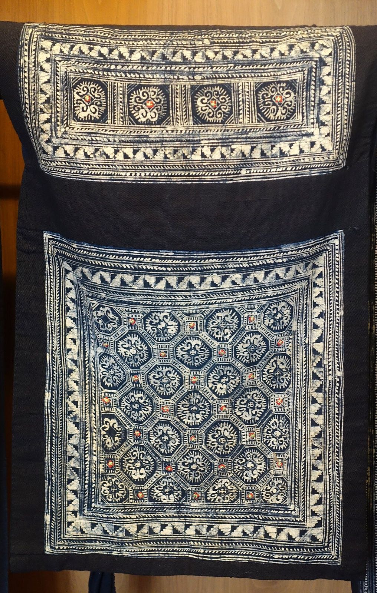

The Hmong are a people of the mountains of south-west China and of Vietnam, Laos, Thailand and Myanmar. Most of their traditional textiles were made of hemp: grown by the family, spun and woven by its women, and decorated with batik and embroidery in patterns that say which group the wearer belongs to. The plant is the same species that the laws of all those countries prohibit, and that is one of the reasons the craft is fading.

## From field to loom

Hemp was grown in small plots, by a family or a village. The work that followed belonged to women.

| Stage | What is done |
|---|---|
| Growing | Small family or community plots |
| Drying | The cut plants are dried in the sun |
| Stripping | The fibrous outer layer of the stalk is peeled off and split into short lengths |
| Joining | The lengths are twisted together by hand, end to end, into a continuous thread |
| Weaving | A coarse cloth is woven by hand on a large wooden loom |

It was done alongside everything else. Making and decorating the family's clothes was the responsibility of the women and older girls, and it did not excuse them from the house, the children or the fields. Sewing was work for late at night and for the pauses in other work.

## Batik and flower cloth

The plain white hemp is then decorated in two ways.

**Batik.** A pattern is drawn on the cloth in hot beeswax with a small copper-nibbed tool. The cloth is dipped several times in indigo, dried, and boiled to melt the wax, leaving white lines on blue. Hmong batik runs to bold geometric designs. It is practised by the Blue and Green Hmong, for skirts, baby carriers and other pieces, and not by the White Hmong.

**Paj ntaub.** "Flower cloth" is embroidery, done only by women, in cross-stitch, chain-stitch and satin-stitch, with appliqué and reverse appliqué. The motifs are stylised and geometric, and vary by region and group. Girls begin to learn from their mothers and grandmothers as young as three, and skill in it counts for a great deal: it stands for industry, creativity and discipline, and it weighs in courtship. A woman who marries learns the patterns of her husband's clan from her mother-in-law.

## Cloth for the dead

The most important textiles a Hmong woman makes are for funerals. Well before they are needed she prepares burial clothes for her parents, her parents-in-law and her husband, and gives them as a mark of devotion: a robe, a collar, a pillow, a pair of slippers. Dressed in them, the dead are believed to be recognised by their ancestors and able to join them.

Hemp has the same place at Korean funerals, where the shroud and the mourners' clothes are of [sambe](/culture/traditions/sambe/).

## Why few still make it

Most Hmong textiles today are made from bought hemp fabric or from lighter commercial cloth. Three things are given as reasons: the labour the old process takes, the scattering of the Hmong across many countries, and "the inconsistent legality of marijuana".

The last is a matter of the laws recorded on this site. Each of the countries where most Hmong live bans cannabis.

| Country | Law |
|---|---|
| [Vietnam](/country/vn/) | Banned in the south in [1968](/history/vietnam-ban-1968/); [the death penalty for trafficking from 1989](/history/vietnam-death-penalty-1989/) |
| [Laos](/country/la/) | The [Law on Narcotics of 2007](/history/laos-law-on-narcotics-2007/). In 2022 Laos [approved hemp for medical use](/history/laos-hemp-for-medication-2022/) |
| [China](/country/cn/) | Cannabis classed as a narcotic in 1985. Yunnan tried to become ["cannabis free" from 1998](/history/china-yunnan-eradication-1998/), then [licensed industrial hemp in 2010](/history/china-yunnan-hemp-2010/) |
| [Thailand](/country/th/) | The [Cannabis Act of 1935](/history/thailand-cannabis-act-1935/) |

The craft survives as heritage and as trade. Families sell traditional and new pieces at the Hmong New Year, and the embroidered "story cloth" has become the most widely recognised modern Hmong textile.
