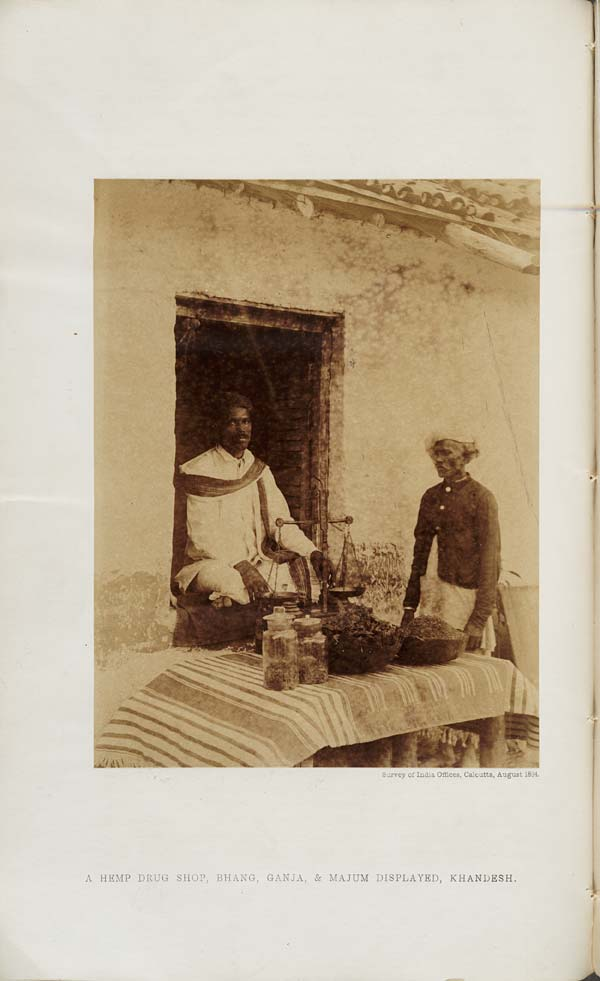

In parts of [India](/country/in/) cannabis is sold over a counter with a government licence. The product is *[bhang](/culture/language/bhang/)*, a paste or drink made from the leaves, and the shops that sell it are licensed by the state's excise department, the same department that licenses liquor. A hand-painted sign in Mirzapur, in Uttar Pradesh, says it plainly: *sarkari bhang ki dukan*, "government bhang shop".[@1,2]

The shops exist because India's national law draws a line through the plant. Ganja, the flowering tops, and charas, the resin, are banned everywhere. The leaves are not, so each state decides what to do with bhang, and some sell it.

## A licence older than the ban

Licensing cannabis is older in India than prohibiting it. From [1793](/history/india-bengal-ganja-licences-1793/) the East India Company required anyone retailing ganja in Bengal to buy a licence, and in [1798](/history/india-bhang-tax-1798/) its Board recommended taxing cannabis preparations. Through the nineteenth century the hemp drugs were a source of excise revenue, sold from licensed shops.

In 1894, the year the [Indian Hemp Drugs Commission](/history/india-hemp-drugs-commission-1894/) reported on them, a photograph printed by the Survey of India showed such a shop: a vendor in Khandesh seated at his door, with bhang, ganja and *majum*, a sweet preparation akin to Morocco's [maâjoun](/culture/traditions/maajoun/), set out in jars and baskets on a table before him.[@3]

## The leaf left out

The modern shops depend on a choice made at the United Nations. In negotiating the Single Convention, India's delegation secured a definition of cannabis that [excludes the leaves](/history/india-bhang-exemption-1961/), so that bhang could go on being consumed. When India passed its [narcotics law in 1985](/history/india-ndps-act-1985/), banning ganja and charas nationwide, it kept the same exclusion. Bhang was left to the states.

They have gone different ways. Some license its sale; Gujarat [took it off its list of intoxicants in 2017](/history/india-gujarat-bhang-2017/); others ban it under their own prohibition laws. In 2022 the High Court of Karnataka [held](/history/india-karnataka-bhang-ruling-2022/) that bhang does not fall under the national narcotics act at all.

## How Uttar Pradesh runs them

Uttar Pradesh treats its bhang shops as part of the excise system, beside its country-liquor, composite and model liquor shops. Its excise policy for 2026–27 sets out the rules.[@1]

| | Rule for bhang retail shops, 2026–27 |
|---|---|
| Allotment | Renewal of existing licences, then an e-lottery for the rest, together with the liquor shops; shops still unsettled after the last round cease to exist |
| Licence fee | Last year's fee plus 10 per cent, rounded up to the next ₹1,000 |
| Fees to apply and renew | ₹25,000 processing fee (non-refundable); ₹6,500 renewal fee |
| Limit | No applicant may be allotted more than two shops of any kind, liquor or bhang |
| Hours | 10 am to 10 pm, as for liquor shops |
| Supply | Wholesale suppliers of bhang are selected, and their rates approved, by the Excise Commissioner |
| Oversight | Shops are geo-fenced; police may not close or seal a licensed shop without the licensing authority's permission |

Applicants must upload their PAN card, a solvency or property certificate and income-tax returns, as for a liquor shop.[@1] The bhang shop is, in the state's paperwork, a small liquor licence that happens to sell cannabis.

## A legal shop for a festival drug

Most of the custom these shops serve is old and religious: bhang offered to Shiva and drunk at [Holi](/culture/traditions/bhang-at-holi/) and Shivaratri, mixed into milk, sweets and [thandai](/culture/traditions/thandai-gatherings/). The shops make that custom part of the state's revenue. A few steps away the same plant's flowers, sold as ganja, can bring a prison sentence under the 1985 act.
