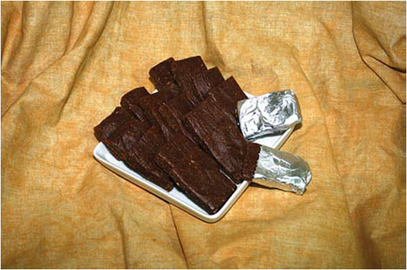

*Maâjoun* is a Moroccan confection made with cannabis: a kneaded paste of almonds, walnuts, aniseed and often cannabis seed, scented with nutmeg, mace, cardamom and poppy seed, bound with olive oil or honey, and made active with cannabis resin ([hashish](/culture/language/hashish/)), leaves or oil. It is cut into small pieces and eaten with hot tea.[@1,3] The name is Arabic *maʿjūn*, the passive participle of *ʿajana*, "to knead": a paste or compound.[@5]

What makes it more than a recipe is how the same confection changes meaning. Khalid Hadji, who interviewed people in [Morocco](/country/ma/), found maâjoun among young men on the margins, craftsmen, Gnawa and ʿIssawa musicians, and in prominent families, where it is served according to a set ritual in chosen company. In one setting it is a street narcotic; in another, a refined delicacy. The difference lies in the company, place and manner of eating.[@1]

## A paste from the pharmacy

In the medicine of the medieval Islamic world, a *maʿjūn* was a compound remedy made into a paste. Hadji points to Avicenna's *Canon*, a fourteenth-century treatise by Najm al-Dīn Maḥmūd, Dāwūd al-Anṭākī's sixteenth-century *Tadhkira*, and al-Hārūnī's thirteenth-century manual, with a chapter on forty-seven medicinal pastes. Almond pastes, he notes, were used to carry a remedy because they acted faster than a decoction.[@1]

The resemblance is suggestive, not proof. The pharmacopoeias show the form and its medical use, not a recipe passing unchanged from a medieval manuscript to a Moroccan gathering. Hadji does not claim an unbroken line. What the sweet shares with the pharmacy is a method — grinding, mixing, binding — and a name.[@1,5]

A familiar relative is *sellou*, the toasted-flour confection eaten during Ramadan and at a child's naming feast. Hadji compares maâjoun's composition to sellou's, with cannabis added, and reads the resemblance as a way of slipping the forbidden past watchers: something close to a narcotic, presented as an apparently lawful pastry.[@1]

## The afternoon gathering

The older form survives, Hadji writes, among people who keep to the "rules of the art". Gatherings begin after the afternoon prayer, at the end of the working day and often at weekends, in a garden or a house at the edge of town, away from neighbours and the police. Men of the middle classes hold them, sometimes with people of high standing; women of the same classes hold separate gatherings in a large house with no men present.[@1]

At the men's *zhou*, "pleasure", there may be wine, song and joking as well as [kif](/culture/language/kif/) and maâjoun; poets composed *malhun* verses about such evenings. At the women's, maâjoun is passed round on plates to be tried, amid song, dance and confidences. Hadji's informants described it as a means to drop the social mask and talk freely, not to get as intoxicated as possible.[@1]

Some believed the custom imitated the entertainments of the Makhzen, the royal court, a claim that would explain the presence of notables and the emphasis on quality. That is an oral tradition, reported as such.[@1]

Hadji's account comes from interviews in a particular milieu, not a national survey; it does not establish that every Moroccan gathering follows this script.[@1]

## Old recipe, new street forms

Alongside the classic paste, Hadji lists street varieties with blunt names.[@1]

| Name | What Hadji's informants described |
|---|---|
| *Barbouqa* | Finely cut kif or plant leftovers crushed into yoghurt, sellou or biscuits |
| *al-Qortassa*, "the bullet" | Spices and olive oil with a large dose of cannabis, sold wrapped in plastic like a cartridge |
| *Chkilita*, "the bit of chocolate" | Another name in current use |
| *Assamaka*, *al-Qatila* ("the killer") | Mixed with pills or psychiatric medicines; described as dangerous |

These mixtures have little to do with the old recipe, and Hadji treats them as something apart.[@1] But the line between traditional and adulterated is older than the street names suggest. A 1945 toxicology account, quoted in a 1956 United Nations report, lists a celebrated ma'joun recipe with datura seeds and belladonna berries alongside kif, almonds, walnuts, honey and butter. Not every old preparation was benign, and not every dangerous mixture is a recent invention.[@2]

A 2013 clinical case report from Fez describes two infants poisoned by maâjoun; one had eaten a piece thinking it was chocolate; his tests found cannabis and benzodiazepines.[@4]

## Food, drug and the law

Hadji calls maâjoun "both licit and illicit, food and drug". Socially it is tolerated in private; in his reading it is not recognised by law, though not explicitly prohibited either.[@1] Its cannabis is another matter. Independent Morocco [banned kif in 1956](/history/morocco-kif-ban-1956/) and restated the prohibition in its [1974 narcotics law](/history/morocco-narcotics-law-1974/). The [2021 law](/history/morocco-law-13-21-2021/) that licensed cannabis for medical and industrial use left unlicensed production and use under the old ban, with no route for recreational cannabis food. A maâjoun made with cannabis is therefore still outside the law.

It is the eaten counterpart of [the sebsi](/culture/traditions/kif-and-the-sebsi/), but not its simple opposite. In Hadji's account, *kif* is the smoked form, associated with the pipe and everyday sociability; maâjoun is the eaten form, associated with the table and the chosen gathering. The same *zhou* may include both, so the contrast is one of setting and manner rather than of two separate substances.[@1]

The confection remains outside the licensed system: a private delicacy for some, a street narcotic for others, and in law a cannabis preparation still covered by the old prohibition.[@1]
