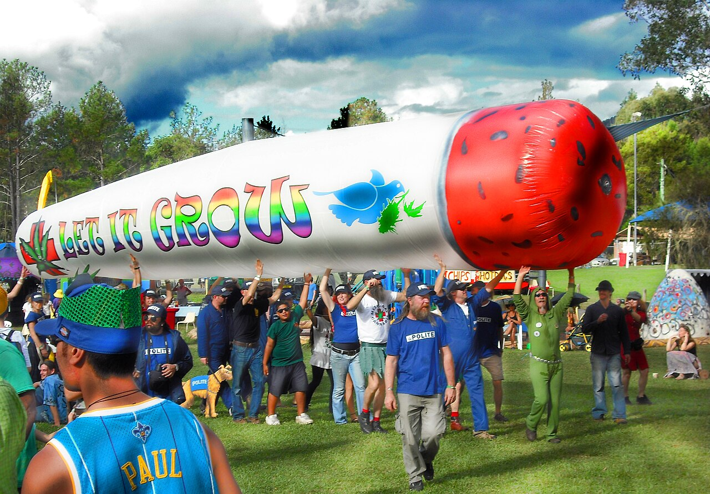

[Nimbin](https://en.wikipedia.org/wiki/Nimbin,_New_South_Wales) is a small town in the Northern Rivers region of New South Wales that calls itself, not without reason, the cannabis capital of Australia. On the first weekend of May it holds MardiGrass, a weekend of parades, music, competitions and speeches for the reform of cannabis law. It has been held since 1993, and it began with a confrontation with the police.

## Aquarius

The town's character dates from 1973, when the hippies of the Aquarius Festival came to it. A drug culture has been part of the town since, together with communes in the hills around and a great deal of public art. At Aquarius itself, when police tried to arrest people smoking openly, a crowd of 6,000 rioted. In 1976 police raided the nearby Tuntable Falls cooperative before dawn.

Cannabis had been banned in Australia since the 1920s, [state by state](/history/australia-ban-1926/). A [royal commission in 1979](/history/australia-royal-commission-1979/) rejected decriminalisation.

## How MardiGrass started

After a decade of raids, street searches and arrests in Nimbin, residents discovered in March 1993 that undercover police officers had been buying cannabis in the town. Some of them chased the officers back to the police station and pelted it with eggs and toilet paper.

Worried about the publicity, members of the Nimbin HEMP Embassy, a reform group founded in 1992 out of an earlier group, Nearly NORML Nimbin, decided on a peaceful protest that ordinary people could join. HEMP stands for Help End Marijuana Prohibition. The idea was Bob Hopkins's.

On 1 May 1993 a small group gathered by the creek in bright clothes, Hopkins in a nun's habit playing a tuba, behind a giant joint made from a sheet and household odds and ends. By the time they reached the police station they were, by most accounts, more than a thousand. The police watched. That evening the organisers vowed to hold a MardiGrass every year until the prohibition of cannabis ended.

## What happens

| Event | |
|---|---|
| The Protest Rally and Parade | On the Sunday: it gathers opposite the police station and marches through the village to the Peace Park, with the "Big Joint" and the dancing Ganja Faeries |
| The Hemp Olympix | Joint rolling, the bong throw, the Growers Iron-person |
| Other events | The Nimbin Cannabis Cup, the Harvest Ball, the Pickers' Ball, music and dance parties |
| The Plantem | A street-theatre hero modelled on the comic-strip Phantom, created by Hopkins and the festival's mascot. The Phantom's publishers threatened legal action in 2016 |

The festival is run entirely by volunteers and takes part in the [Global Marijuana March](/culture/traditions/global-marijuana-march/).

## The law around it

New South Wales still prohibits cannabis. Elsewhere in Australia the law has moved. The Australian Capital Territory [legalised possession and growing at home in 2020](/history/australia-act-legalises-2020/). A federal bill to legalise cannabis was [introduced in 2023](/history/australia-legalising-cannabis-bill-2023/) and [rejected by the Senate in 2024](/history/australia-senate-rejects-legalisation-2024/).

MardiGrass is a protest dressed as a carnival, and its organisers have kept their promise of 1993 for more than thirty years.
