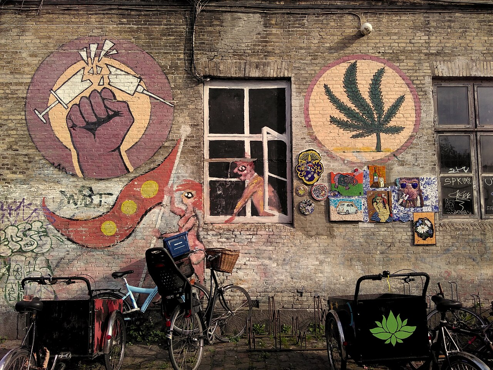

Pusher Street was the main street of [Freetown Christiania](https://en.wikipedia.org/wiki/Freetown_Christiania), the self-governing commune in a former army barracks in the Christianshavn district of Copenhagen. From the 1970s until 2024, hashish and marijuana were sold there openly from stalls, in a country where they were illegal. It was one of Copenhagen's best-known sights. It ended when the residents, after a series of shootings, closed it themselves.

## The freetown

Kathmandu's [Freak Street](/culture/traditions/freak-street/) offers a different history of a famous cannabis district: its shops operated under licences before Nepal closed the market.

Christiania began in September 1971, when squatters occupied an abandoned military base and declared it a free town. The authorities first looked away, then went to court, and in 1989 parliament gave the community a legal footing.

It also belongs to a European network of free cultural spaces. Christiania's cultural association calls the Dutch artists' village [Ruigoord](/culture/traditions/ruigoord/) its sister community. Its account of a delegation to Ruigoord's fiftieth anniversary describes a Free Cultural Spaces symposium and earlier meetings in Christiania. These ties concern art, self-organisation and protecting communal space as well as cannabis. Ljubljana's [Metelkova](/culture/traditions/metelkova/) offers another autonomous cultural setting, with a different legal and social history.

The cannabis trade was there from the start, on a street the residents' council called the "Green Light District". Its defenders argued that concentrating the trade in one place kept it out of the rest of society and kept users away from harder drugs, the same reasoning as the Dutch [coffeeshop](/culture/traditions/the-coffeeshop/). Its opponents said the ban should be enforced in Christiania as everywhere else.

## Soft yes, hard no

The commune drew its own line between drugs.

| Year | What happened |
|---|---|
| [1979](/history/denmark-christiania-junk-blockade-1979/) | The "Junk Blockade": for 40 days residents patrolled the freetown, drove out the dealers of hard drugs and helped addicts into treatment. Cannabis stayed |
| [1984](/history/denmark-christiania-biker-gang-1984/) | After fighting between motorcycle gangs, the Bullshit Motorcycle Club controlled the trade |
| 1987 | After a dismembered body was found in a Bullshit shop, the gang was cleared out. Biker jackets were banned in Christiania |
| [2003](/history/denmark-fight-against-drugs-plan-2003/) | The government's action plan *The Fight Against Drugs* ends the tolerance of small-scale possession and calls for closing the market in Christiania |
| 2002–2004 | The government pressed to make the trade less visible. Sellers draped their stalls in military camouflage netting as a joke; after police raids in 2004 the trade returned |

The street had its own look: makeshift stalls with spray-painted signs naming the varieties on offer, and lookouts who warned of police raids, which by 2023 came almost daily.

## Gangs and guns

The trade was illegal, so it was run by those who run illegal trades. In 2005 a man was shot dead in a dispute over it. In August 2016 a man carrying the day's takings shot two police officers and a bystander. The residents voted the next day to tear down the stalls, and asked friends of the freetown not to buy cannabis there; sales were estimated to have fallen by three-quarters. The trade came back.

In August 2023 masked gunmen killed a man and wounded four others in a gang conflict over the market. Residents blocked the entrances to Pusher Street with concrete and asked the state for help. Their position had become that the money "didn't finance Christiania, but gangs".

## The end

On [6 April 2024](/history/denmark-pusher-street-closed-2024/), in an operation agreed between the police and most of the residents, the paving of Pusher Street was dug up and the stalls removed for good.

Danish law had not changed. The [Euphoriant Substances Act of 1955](/history/denmark-euphoriants-act-1955/) still bans possession. What ended was a tolerated exception, closed by the people who had defended it for fifty years. In the same years Denmark ran a [medical cannabis pilot](/history/denmark-medical-pilot-2018/), which it later made permanent.
