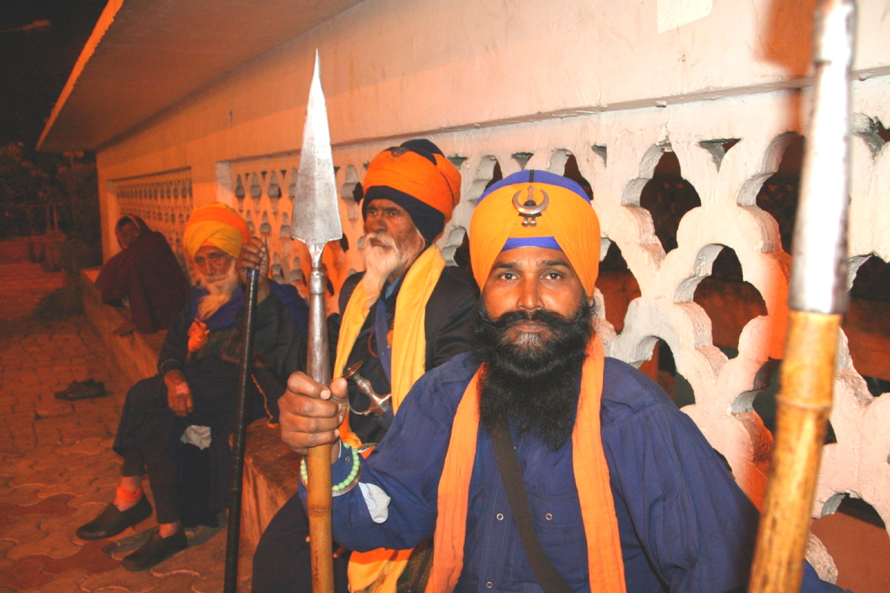

The Nihang are an armed order of Sikhs, recognisable by their dark blue robes and tall turbans, who regard themselves as keepers of the faith's warrior tradition. At their festivals they drink a preparation of cannabis leaf called *shaheedi degh*. Mainstream Sikhism forbids all intoxicants, and the two positions have never been reconciled.

## The drink

It is cannabis leaf crushed and taken as a liquid: [bhang](/culture/language/bhang/) under another name. The Nihang call it *sukha*, or *sukha parshaad*, "comfort-gift", and *shaheedi degh*, the drink of martyrs. Each Nihang encampment, or *dera*, has a place set aside where it is prepared.

Two rules mark it off from other cannabis use. It is never smoked, since smoking of any kind is forbidden in Sikhism. And Nihangs who drink it strictly shun tobacco and alcohol.

It is drunk above all in Punjab at [Hola Mohalla](https://en.wikipedia.org/wiki/Hola_Mohalla), the three-day festival at Anandpur Sahib that falls a day after Holi, when pilgrims camp for a week to watch displays of fighting skill, and at Vaisakhi. At some Sikh shrines, including the Takht at Hazur Sahib, it is offered as a holy food.

## The Nihang account

The order's explanation is military. In the wars that followed the death of the tenth Guru, Gobind Singh, the drink is said to have dulled the pain of wounds, so that fighters recovered and fought again. Some Nihang groups also say it helps in meditation. A BBC report put it that they traditionally drank it "to become closer with God".

## The case against

The founder of Sikhism is on record against it. When the Mughal emperor Babur offered [Guru Nanak](https://en.wikipedia.org/wiki/Guru_Nanak) bhang, Nanak is said to have declined with a verse:

> Fear of Thee, O Lord, is my bhang, and my mind the pouch in which I carry it. Intoxicated with this bhang I have abandoned all interest in worldly concerns.

The official code of conduct, the Sikh Rehat Maryada, is plain: "A Sikh must not take hemp (cannabis), opium, liquor, tobacco, in short, any intoxicant." For an initiated Sikh, taking intoxicants is one of the four cardinal sins, to be confessed before the congregation and atoned for by service.

Outsiders were also unkind. European visitors to the Sikh kingdom wrote of the Nihang with hostility, and accounts of the order's decline in the nineteenth century blame cannabis among other things. In the census of 1892, 1,376 people recorded themselves as Nihang; ten years later, 431.

## The dispute of 2001

In 2001 the Sikh clergy moved to ban the drink. Baba Santa Singh, head of the Budha Dal, a Nihang order, refused to accept the ban together with twenty other Nihang leaders, on the ground that it was a traditional Sikh practice. He was later excommunicated over a different matter, and his successor agreed to give up bhang. The custom has continued in other groups.

## The law

Indian law has nothing to say on the religious question, because it does not reach the leaf. The [Narcotic Drugs and Psychotropic Substances Act](/history/india-ndps-act-1985/) defines cannabis as the resin and the flowering tops, and leaves bhang to the states. So the national act does not reach shaheedi degh, where it does reach a sadhu's [chillum](/culture/traditions/sadhus-and-the-chillum/) of charas.
