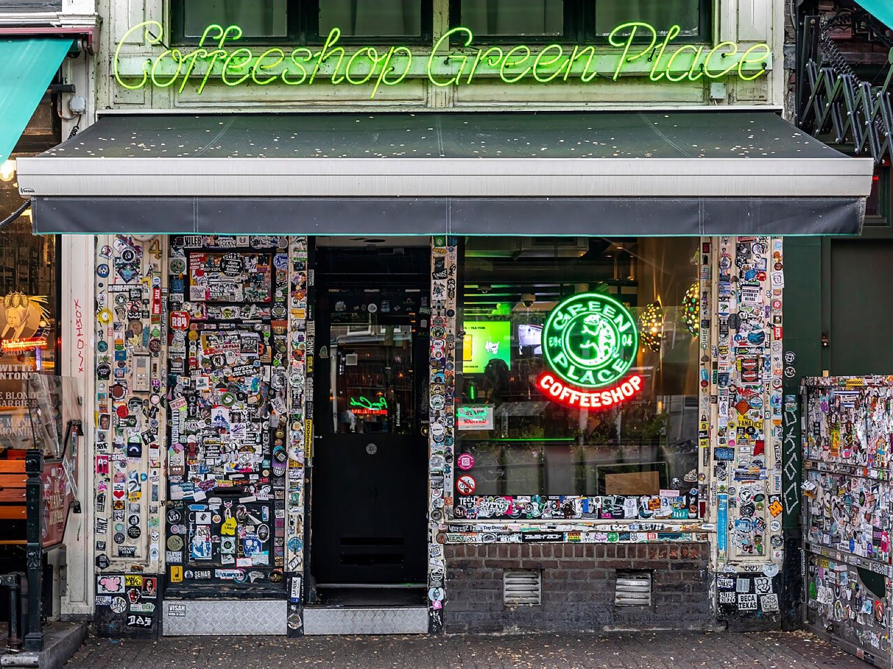

A Dutch coffeeshop is a café where adults can buy and smoke small amounts of cannabis. It has existed since the 1970s, and it has never been legal. The shop is tolerated: the sale is, in the Dutch phrase, illegal but not punishable. Half a century of rules, habits and arguments has grown up around that sentence.

## Why the Dutch did it

The idea came from a government commission. In [1972 the Baan Commission](/history/netherlands-baan-commission-1972/) argued that drugs should be ranked by risk, and that keeping cannabis users away from the sellers of heroin mattered more than punishing them. The [Opium Act of 1976](/history/netherlands-toleration-1976/) put cannabis on a list of its own. In 1980 the government [published the guidelines](/history/netherlands-dealers-not-prosecuted-1980/) under which shops selling small amounts would be left alone.

The policy has a name, *gedoogbeleid*, the policy of tolerance: an official set of instructions to prosecutors saying when an offence is not to be pursued. Dutch courts have long treated it as decriminalisation in fact. The statute itself stays on the books, largely because the international treaties require it.

## The house rules

A shop is left alone as long as it keeps to the national criteria.

| Rule | |
|---|---|
| No advertising | |
| No hard drugs on the premises | |
| No one under 18 inside, and no sale to them | |
| No more than five grams to one person in a day | [Cut from 30 grams in 1996](/history/netherlands-five-grams-1996/) |
| No more than 500 grams in stock | |
| No nuisance | |
| No alcohol | |

Breaking a rule can close a shop for months or for good.

## Customs the rules made

Because a shop may not advertise, it has to signal. Many fly the green, gold and red of the Ethiopian flag, show other symbols of Rastafari, or paint a palm leaf on the sign. The look has become a style of its own, and painters are hired to cover the walls in reggae imagery.

Most shops serve drinks and food as well.

## The back door

The system has a contradiction at its centre. The shop may sell at the front door. Nobody may lawfully grow the cannabis or bring it to the back. "The front door is open, but the back door is illegal." Growers and wholesalers are prosecuted, and how a shop comes by its stock is, by convention, not asked.

Mayors have pressed the point for years. In 2008 thirty-three of them, from large towns and small and from several parties, met for a *wiettop*, a "weed summit". In 2014 a judge found two growers guilty and declined to punish them.

The answer has been an experiment. [Since December 2023](/history/netherlands-supply-experiment-2023/) coffeeshops in a set of municipalities, beginning with Breda and Tilburg, have been supplied by licensed growers, and since [April 2025](/history/netherlands-regulated-supply-only-2025/) the shops in ten municipalities may sell nothing else.

## Tourists

The other long quarrel is over visitors. Border towns complained of "drug tourists" from elsewhere in Europe. Maastricht introduced a residents' pass in 2005, and in 2010 the European Court of Justice ruled that it could. A [national rule of 2012](/history/netherlands-residents-only-2012/) barred non-residents, left the enforcement to mayors, and has been applied in a few southern towns. Amsterdam never applied it.

## An export

The coffeeshop has been copied in spirit more than in law. Spain's [cannabis social clubs](/culture/traditions/cannabis-social-clubs/) work on the opposite principle, non-profit and closed to outsiders. Cannabis cafés and bars are now widespread in Thailand, and exist in Canada and parts of the United States.
