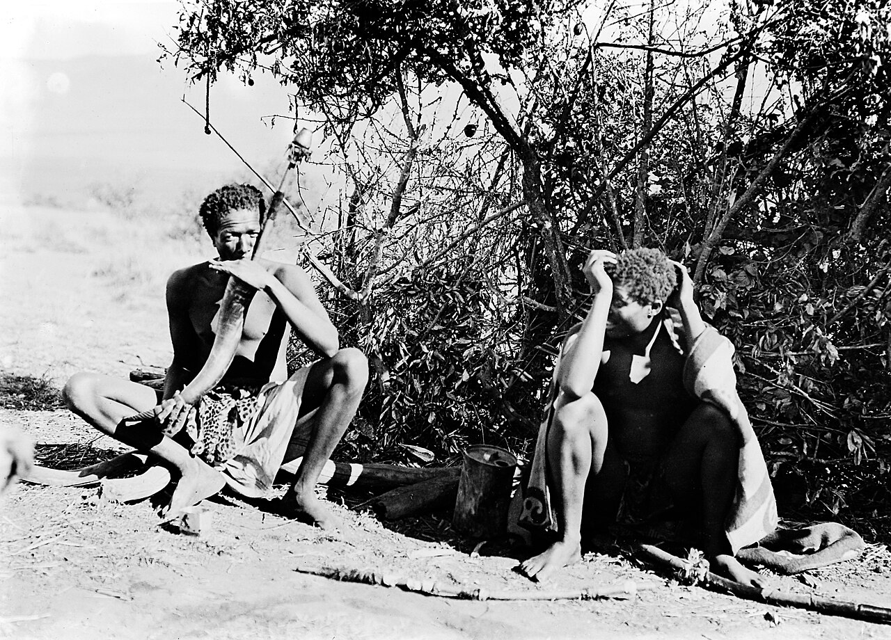

Smoking [dagga](/culture/language/dagga/) through a water pipe makes the mouth fill with saliva. In the
nineteenth and early twentieth centuries, men in eastern [South Africa](/country/za/) and
[Swaziland](/country/sz/) turned that into a board game. Taking turns with a long hollow reed, they
blew frothy bubbles of spit onto a smooth floor and moved them as pieces: soldiers, fences, the
lines of a maze. The game is recorded among Zulu, Swazi and Tonga smokers.

It is one of the stranger customs in the cannabis record, and one of the best attested. Missionaries,
a Zulu dictionary and anthropologists all describe it, and the Zulu language had a name for the
pattern.

## How it was played

The geographer Chris Duvall summarises the sources: players made
"mock fences of frothy saliva bubbles blown through long reeds", while trying to put lines of bubbles
through the gaps in their opponents' fences. The anthropologist Brian du Toit quotes an account of
Zulu men at times of war, letting the saliva pass through "a hollow stem of tambootie grass" so as
to "trace a labyrinth" on the floor.

Du Toit also summarises a fuller description by Braatvedt, published in 1949:

| Element | What it stood for |
|---|---|
| The level ground in front of the smokers | The battlefield |
| The saliva bubbles blown through the reed | The two armies |
| Each player's turn with the reed | A move |
| Encircling the other side's bubbles | The aim of the game |

According to that account the bubbles, thickened by the smoke, would not break for a long time, and
the game was "a very exciting one, for the old men".

## The words for it

| Word | Language | Meaning, as recorded |
|---|---|---|
| *insangu* | Zulu | Cannabis |
| *igudu* | Zulu | A horn-based water pipe |
| *u-Sogerre* | Zulu | The maze game, or the bubble pattern |
| *tshuma sogexe* | Zulu | "To trace a labyrinth" with saliva (as quoted by du Toit) |

Duvall notes that A. T. Bryant's *Zulu-English Dictionary* of 1905 had several other words linking
saliva and cannabis smoking. The spellings differ between sources and are given here as each
prints them.

## Who played, and why

The accounts tie the game to the pipe that adult men shared; Duvall adds that herders smoked to
relieve boredom and keep going. Duvall reads the games as simulations of people and animals moving
across a landscape, and wonders whether cannabis helped herders think through the movement of
livestock; he offers this as a possibility, not a finding. Du Toit records Zulu warriors smoking
before an attack, and old men playing the bubble game as their pastime.

Almost everything known comes from outsiders: missionaries such as J. Tyler, who called the
practice "filthy and baneful", travellers and colonial ethnographers. Their accounts describe what
they saw; they do not say how the players themselves talked about the game.

## Pushed out by the ban

Swaziland's [Opium and Habit-forming Drugs Act](/history/swaziland-habit-forming-drugs-act-1922/)
and [South Africa's national ban](/history/south-africa-national-ban-1922/) both date from 1922.
[Officials told police to go easy](/history/south-africa-enforcement-compromise-1922/) on [older men's pipes](/culture/traditions/the-morning-pipe/)
in remote areas, but du Toit writes that the custom was nonetheless "forced underground": the old
man with his horn pipe was "now encountered only in ethnographies". A game that needed a pipe, a reed,
a smooth floor and an audience did not survive that. When South Africa's Constitutional Court
[protected private use](/history/south-africa-constitutional-court-2018/) in 2018, the old pipe
customs were long gone; none of the sources read for this entry records a revival of the game.
